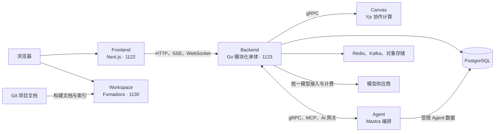

本文是织光的项目级架构入口。运行命令、工具链与质量门禁见[项目工程规范](./PROJECT.md)。产品范围和交付边界见[产品总览](./content/design/24-产品总览与交付边界设计.md)。当前拓扑根据仓库源码和 Compose 配置整理，项目知识库扩展为待评审设计。

## 1. 摘要

Glowloom 为个人和团队提供剧本、主体、画布、分镜、媒体生成与制作工作台。Go 模块化单体拥有业务权限、正式数据、任务和费用。独立 Canvas 和 Agent 运行时分别负责协作候选计算和 Agent 编排。独立 Workspace 从 Git 文档构建研发知识站。

## 2. 参与者与职责

| 角色                   | 职责                                                     |
| ---------------------- | -------------------------------------------------------- |
| 创作者与项目维护者     | 编辑内容、采用创作结果、管理项目资料与共享约定           |
| Go 业务后端            | 核验项目范围和权限，接受正式版本，执行后台任务并记录费用 |
| Canvas 与 Agent 运行时 | 分别处理协作候选和多 Agent 编排，由 Go 复核业务操作      |
| 研发与运维             | 维护 Git 知识、架构、工程规范和运行证据                  |

## 3. 当前部署拓扑

端口为 Compose 宿主机入口。Go 容器在 `18080` 提供 HTTP；Canvas 和 Agent 的 gRPC 位于各自容器的 `4402`。Go 的 `--role=all` 同进程运行 API、Worker 与 Kafka Relay。Workspace 通过独立的 Next.js 构建提供文档与搜索。 [部署配置](https://github.com/StephenQiu30/glowloom/blob/20e02016a7235c6b46f60b3d5002a7d4a5f09865/docker-compose.yml) · [Go 运行入口](https://github.com/StephenQiu30/glowloom/blob/20e02016a7235c6b46f60b3d5002a7d4a5f09865/backend/internal/app/all.go)

## 4. 业务域与权威数据

| 边界                 | 拥有的事实或职责                                                                     | 设计入口                                                                                                                                                                                                                          |
| -------------------- | ------------------------------------------------------------------------------------ | --------------------------------------------------------------------------------------------------------------------------------------------------------------------------------------------------------------------------------- |
| 身份与空间           | 账号、会话、个人空间、团队成员资格及项目访问范围                                     | [用户系统](./content/design/01-用户系统总体设计.md) · [团队创作](./content/design/21-团队创作与成员管理设计.md)                                                                                                                   |
| 创作与媒体           | 项目、画布、正式剧本、主体及媒体资产的当前版本和采用关系。媒体域维护对象定位与可见性 | [项目与画布](./content/design/13-项目与画布创建及一致性详细设计.md) · [主体库](./content/design/25-统一主体库与创作引用设计.md) · [文件与对象存储](./content/design/08-文件上传服务调研与架构设计.md)                             |
| Canvas               | 无状态计算 Yjs 协作候选。Go 接受并持久化修订，负责 WebSocket 广播                    | [画布协作](./content/design/17-画布Yjs协作编辑设计.md)                                                                                                                                                                            |
| Agent 与执行         | Agent 保存会话、运行与编排状态。Go 校验授权、业务工具、模型请求和费用回执            | [Agent 架构](./content/design/48-Agent服务Mastra架构与技术选型设计.md) · [短剧编排](./content/design/49-AI短剧制作三层Agent与六阶段Workflow设计.md) · [模型计价与结算](./content/design/34-积分消耗系统与模型真实计价体系设计.md) |
| Workspace 与项目知识 | Workspace 发布 Git 工程文档；登录后的项目知识由 Go 受权读取，项目证据由来源业务维护  | [Workspace 设计](./content/design/45-Workspace官方Fumadocs设计.md) · [创作项目知识库](./content/design/50-创作项目知识库设计.md)                                                                                                  |

PostgreSQL 保存业务记录、版本、回执和持久任务。`backend/db/schema.sql` 是结构定义，Agent 通过受限数据库角色访问框架记忆与服务级运行状态。对象存储保存媒体字节，数据库登记关联及访问状态。部署和离线结构变更按[工程规范](./PROJECT.md#3-数据与契约)执行。

## 5. 关键链路

1. **项目与画布。** 浏览器经前端同源入口发起业务请求或协作连接；Go 验证会话、空间和项目。协作候选经 Canvas 计算后由 Go 核对修订、持久化并广播。
2. **Agent 创作。** Go 受理请求并签发运行权限，经 gRPC 启动 Agent。Agent 使用内部 MCP 读取业务证据，或经 AI 网关选择模型、进行费用准入及结算。创作候选经业务采纳流程形成正式项目版本。
3. **资料查询。** 现有 Agent 工具查询当前项目证据并带回来源、版本和定位。拟新增项目知识库面板和资料管理流程，复用同一 Go 检索及权限边界。

## 6. 知识库设计

工程知识由 Git 维护。本页和 [PROJECT](./PROJECT.md) 放在 Workspace 服务根目录，按需求、设计、PRD 与 Plan 管理的专题仍在 `content/`，由 Fumadocs 提供阅读、搜索与 Markdown 原文。

创作项目知识库首版拟覆盖已采用剧本、项目设定、共享约定及显式纳入的 TXT／Markdown。维护者发布就绪版本后可查；撤回先阻断读取，再清理派生索引。创作者与 Agent 共享项目证据范围，检索、入模与打开引用根据当前授权和版本复核。接口、数据、降级和验收见[创作项目知识库设计](./content/design/50-创作项目知识库设计.md)。

- [Archify · 资料入库、版本发布与撤回](/design/project-knowledge/knowledge-intake.html)
- [Archify · 检索、Agent 引用与回源](/design/project-knowledge/knowledge-retrieval.html)
- [入库图源](/design/project-knowledge/knowledge-intake.workflow.json) · [检索图源](/design/project-knowledge/knowledge-retrieval.workflow.json) · [Archify 许可](/design/project-knowledge/archify-license.txt)

## 7. 关键取舍

- Go 通过进程内接口组织业务域，跨域不变量使用 PostgreSQL 事务；跨服务接线使用版本化 Protobuf。详细约束见 [Go 模块化单体设计](./content/design/47-Go模块化单体架构与RPC集成设计.md)。
- 项目源资料由所属业务域维护，证据索引可以重建，Agent 对话与偏好独立维护。现有词法检索可独立使用，语义召回由项目策略及模型预算控制。
- 收费请求使用统一模型网关和原始回执。重放、恢复和正式采用各自保留业务身份和版本。 已确认的目标架构由 Agent 服务统一执行模型调用并编排计费，Go 管理模型接入、预设、验证发布及钱包写入。现有部署拓扑沿上文。 [设计48 §7.4.1](./content/design/48-Agent服务Mastra架构与技术选型设计.md#ai-runtime-ownership-review)。

## 8. 实施与验证入口

| 要看什么                     | 入口                                                                     |
| ---------------------------- | ------------------------------------------------------------------------ |
| 工程工具、运行合同与质量门禁 | [PROJECT](./PROJECT.md)                                                  |
| 需求、方案、验收和实施       | [知识库首页](./content/index.mdx)                                        |
| 产品范围与交付接受           | [产品总览 PRD](./content/prd/10-产品总览与交付边界.md)                   |
| 当前待办与阻塞               | [BACKLOG](https://github.com/StephenQiu30/glowloom/blob/main/BACKLOG.md) |

验证按改动范围记录构建、浏览器、隔离集成和实际供应商结果；实施和真实部署以对应环境证据为准。
