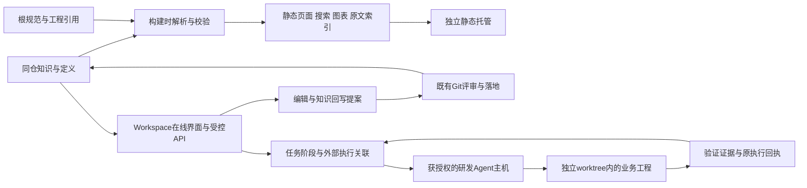

# Workspace 知识库与研发工作流服务设计

文档状态：技术选型与双构建边界已确认，本地实施依SRC-WS-08；真实TTS按SRC-WS-09禁用。唯一原始需求：[需求28](../requirement/28-Workspace知识库与研发工作流需求.md)，来源 SRC-WS-01～09。外部依据：[Chat4j与静态知识库调研](../research/2026-11-14-Chat4j与Workspace静态知识库调研.md)。已确认方向、设计建议与待确认事项分别标注；发布仍需单独授权。实施状态只见 [BACKLOG](../../../BACKLOG.md#workspace-20261114)。

## 1. 摘要

建立与业务代码同仓、可独立运行和部署的 `workspace/` 服务，承载完整研发知识、静态可视化阅读、Skill、研发工作流与知识回写。项目知识正文仍由 Git 管理，人和 Agent 使用同一原文及版本；业务代码、数据库结构、产品会话与创作执行状态保留各自权威。

按SRC-WS-07确认，以同一内容管线支持两种明确的交付：**静态阅读产物**提供目录、全文、检索、图表和原文引用；**在线协作服务**增加编辑提案、执行记录、Agent 接入和验收交接。静态页面不伪装成可以写文件、运行任务或检查实时部署状态的后端。

依据SRC-WS-05补充文档朗读与时序高亮：静态站可播放经过审阅的预生成音频及定位数据，在线生成与声音复刻分别授权。参考演示中的高亮跟随不等于已经证明自动滚动；本稿将可选自动滚动与语音高亮分开设计。

当前设计文档仍写在 `docs/`。迁移实施后，项目知识统一进入 `workspace/content/`，旧 docs 不再维护第二份正文；根工程规则与结构契约保留原位置，通过目录关联展示。

## 2. 参与者

| 角色                            | 职责与边界                                                           |
| ------------------------------- | -------------------------------------------------------------------- |
| 项目负责人、产品与设计          | 确认业务范围、知识基线和产品验收；具体人员不预设                     |
| 研发、QA、运维                  | 维护所属设计、实现、验证、运行说明和交接                             |
| 知识维护者                      | 审阅来源、引用、文档修订及可发布范围                                 |
| 研发 Agent                      | 按选定仓库和任务读取知识、使用 Skill、执行获授权动作，提供可复查产物 |
| Workspace 服务                  | 提供知识视图、内容提案、阶段协调、执行关联与验收呈现                 |
| 外部研发 Agent 主机／本地执行器 | 拥有实际模型会话、工具进程、工作目录及原执行句柄                     |
| 现有业务工程                    | frontend、backend、agent、canvas 继续拥有原业务实现和运行职责        |

“产品、研发、QA”等角色首先是内容归属和协作视图。实际读写、执行及发布权限由服务与执行环境检查，不能靠网页勾选或 Skill 文字声明代替。

## 3. 背景

1. 当前已有完整 requirement → design → PRD → Plan、research、templates 和各级导航；根 AGENTS、PROJECT、DESIGN、BACKLOG 分别维护规则、工程、视觉与实施调度。
2. 调研基线有202个受 Git 管理的 docs 文件（199 Markdown、3 CSV），另有被忽略的本机 Obsidian 配置。没有 `workspace/`、知识库站点构建、静态搜索或研发工作流服务；现有四服务 Compose 不能描述为已运行 Workspace。
3. 现有工程采用 Next.js/React/TypeScript/shadcn 与 Node 24；独立 Agent 为 NestJS/Pi Durable，承担产品内创作任务，不能顺带成为具有源码修改权限的研发执行器。
4. 本次用户明确改变原“不建设知识库网站”的目标，要求同仓 Workspace 服务和静态可视化。原有单源、分层、证据、数据库及授权规则继续适用，路径规则在实际迁移时原子更新。
5. Chat4j 已核对公开入口、课程目录和用户提供的图文；AI2CC 会员项目文档返回401，Workspace 专文正文受订阅限制。没有其完整源码或内部目录，不能声称逐项复刻完成。

## 4. 目标

- **G-WS-01：** 知识正文、工程引用、Skill 与流程可从统一入口找到，来源和版本可复查。
- **G-WS-02：** 保留完整文档与主链，迁移不静默删除、重编号、覆盖并行修改或制造双重权威。
- **G-WS-03：** 无业务后端、数据库与模型连接时，静态产物仍支持完整阅读、搜索和图表展示。
- **G-WS-04：** 在线编辑形成可审阅提案；研发任务可关联源码、阶段产物、测试及接受记录，并可交接恢复。
- **G-WS-05：** Skill 标准化、按需发现且版本固定；角色视图、执行权限、Git写入与站点发布分开控制。
- **G-WS-06：** 用真实任务的恢复时间、人工补充、返工、首次接受及总耗时评估效率，不预设提升百分比。

非目标：本专题不改产品业务范围、不重做账号空间或创作 Agent，不建设通用低代码平台、第二个模型运行引擎、全局向量数据库、多租户知识 SaaS 或自动公开全部工程资料。远程发布、真实供应商调用和生产写入需在相应任务中具有明确授权。

## 5. 使用场景

| 场景                  | 触发与前置                                     | 预期结果                                                   |
| --------------------- | ---------------------------------------------- | ---------------------------------------------------------- |
| SC-WS-01 阅读与定位   | 成员打开某个知识版本                           | 从主题或完整目录进入正文，看到来源链和关联工程             |
| SC-WS-02 静态分享     | 选择受允许的提交与内容范围                     | 生成独立可托管的阅读产物，深链接、搜索和图表可用           |
| SC-WS-03 修改设计     | 成员或Agent读取指定基线                        | 提交内容差异，冲突显式处理，经既有审阅流程落地             |
| SC-WS-04 接手研发任务 | 有明确需求、验收、工程和授权                   | Agent读取必要知识，在独立工作目录执行并提供证据            |
| SC-WS-05 使用Skill    | 当前任务匹配受信任技能且依赖满足               | 固定版本使用，工具仍受执行授权约束                         |
| SC-WS-06 中断后接手   | 任务有原句柄和阶段产物                         | 先核对原状态与工作区，不重复派发未知结果的动作             |
| SC-WS-07 知识回写     | 实现与检查产生有效结论                         | 更新所属设计、指南或Plan证据，保持来源和接受边界           |
| SC-WS-08 文档讲读     | 有可读文档及对应版本的朗读产物，或另有生成授权 | 按全文／章节播放，当前句段可定位，成员能随时暂停和独立阅读 |

## 6. 价值

减少成员与Agent重复解释项目、翻找资料、判断陈旧版本及重做交接的成本；让“当前规则、为什么这样设计、实现在哪里、如何证明有效”可沿同一链路回答。静态阅读先解决文档难以浏览和展示的问题，在线协作再解决执行与回写问题，两者拥有独立验收标准。

## 7. 方案

### 7.1 决策与权威归属

**已确认方向：** 同仓 `workspace/` 独立服务、完整知识沉淀、文档迁移、知识界面、Skill、工作流及业务工程协作；本地实施已获SRC-WS-08授权。技术栈与双构建边界已由SRC-WS-07确认；接口字段、存储参数、身份提供方和部署入口仍按决策表明确。

| 内容                               | 唯一权威                                            | Workspace 的处理                           |
| ---------------------------------- | --------------------------------------------------- | ------------------------------------------ |
| 需求、设计、PRD、Plan、调研、模板  | 迁移后的 `workspace/content/` Git原文               | 编辑、索引、渲染、关系与版本视图           |
| 长期协作、工具链、全局视觉         | 根及模块 AGENTS、根 PROJECT、DESIGN                 | 指向原路径的工程资源视图，不复制正文       |
| 当前排期、实施状态、阻塞与下一步   | 根 BACKLOG                                          | 读取和形成修改提案，不维护第二个项目进度表 |
| SQL结构与公共种子                  | `backend/db/schema.sql`、`backend/db/data.sql`      | 关联与只读展示，不生成另一套结构定义       |
| API、源码、测试与部署合同          | 所属业务工程及其生成工具                            | 按提交与路径引用，执行沿用已有命令         |
| 研发Skill与工作流定义              | `workspace/skills/`、`workspace/workflows/` Git原文 | 发现、固定版本、展示依赖与验收             |
| 某次研发执行的尝试、事件和外部句柄 | 在线模式的Workspace运行存储与外部主机原记录         | 保存关联和恢复记录，不改写项目接受状态     |
| 产品Agent、创作任务与资金          | 现有产品服务                                        | 仅按获授权的正式接口引用，不接管执行与账本 |

目录导入不隐含全量公开。初始静态产物为完整团队知识范围，只在本机或有统一访问控制的内部入口提供；公共产物须单独选择明确允许的文档集合。

### 7.2 已确认技术选择与服务边界

SRC-WS-07确认以下技术路线；后续任务核对实际版本、依赖和许可，不重新把选型列为待定，实施版本以workspace/package.json和锁文件为准。

| 层次       | 已确认选择                                     | 责任                                                |
| ---------- | ---------------------------------------------- | --------------------------------------------------- |
| 知识权威   | 标准Markdown／GFM + Git                        | 正文、修订、来源链；CSV及有效附件保留               |
| 界面与服务 | Next.js App Router + React + TypeScript strict | 共用阅读模块，在线采用有限BFF，不增设第二Nest服务   |
| 视觉       | Tailwind CSS + shadcn/ui + Geist／Neutral      | 沿现有组件与视觉基线                                |
| 工具链     | Node.js 24 + pnpm，独立包与锁文件              | 同仓独立构建、测试和发布；具体版本在包清单锁定      |
| 搜索       | Pagefind                                       | 构建时索引允许范围，浏览器查询，无独立搜索服务      |
| 图表       | Mermaid构建时生成受限SVG                       | 保留文字替代及原文，来源关系从正文声明和链接派生    |
| 静态部署   | Next静态导出`output: 'export'` + 普通静态托管  | 不运行Next／Node服务，不接业务API和数据库           |
| 在线部署   | Next `output: 'standalone'` + Node.js 24       | 身份、编辑提案、运行协调与执行器适配                |
| 在线记录   | PostgreSQL独立`dev_workspace` schema与受限角色     | 保存提案、运行、事件及产物引用；正文仍为Git单源     |
| 朗读       | 原生媒体播放 + 版本化音频／cue manifest        | 预生成资源先交付；在线TTS供应商、音色、预算仍待明确 |

VitePress、Astro Starlight仅保留为既有选型比较，不作为本轮并行实施路线；采用它们需要另行变更已确认决策。标准Markdown不扩展为可执行MDX；具体解析库在兼容全量内容后锁定。

`workspace`为研发服务名和部署角色，镜像仓库使用`glowloom/workspace`。静态可直接交付文件；需要容器时使用不可变`static-<release_id>`标签，在线使用`online-<release_id>`标签。二者独立产物，不能把同一标签在两种模式间覆盖。双版同时部署时使用独立入口和明确的部署实例，不共享健康检查或可写运行目录。

Workspace不成为现有四业务服务的启动依赖；静态站不以业务服务、数据库或在线版健康为条件。在线运行存储依赖PostgreSQL，编辑／执行依赖获授权桥和主机，TTS依赖明确选择的供应商；故障影响相应在线能力，不改变业务服务或静态站状态。初始绑定loopback／内部受控入口，端口、正式域名及团队身份待核定，本轮不占用1122／1123或修改Compose。



#### 7.2.1 实施裁决与运行配置

- 版本锁定在包与锁文件：Next 16.3.6、React 19.2.8、Node 24、pnpm 12.4.2；不由文档重复维护所有补丁版本。
- 现有产品已占用 `workspace` schema。研发在线记录使用 `dev_workspace`，受限 `glowloom_workspace` NOLOGIN角色；业务表、租户和产品Agent权限不借用。结构仅进入根 `backend/db/schema.sql`，服务不建表。
- 首个主机为本机 Codex app-server，原生Skill发现和持久thread／turn句柄。执行桥单独持有仓库权限，经认证Unix socket接收有限动作；在线standalone包只持知识快照、运行配置与PG权限，无可写仓库。
- 本机在线入口默认1130，静态预览1131；线上域名和团队身份仍需部署时配置。本机随机访问令牌只建立单所有者能力；不能宣称团队SSO、多人权限或远程生产部署已验收。
- 版本目录为不可变产物，`release.json`记录模式、scope、知识／代码摘要和资源摘要清单；选版先验证清单，原子切换`current.json`，重启相应读取进程。静态包不含Node、PG、执行器；在线构建不连接数据库或Codex。
- 内部静态产物只在本机或受保护入口提供；`--public`在解析、索引、raw、图、音频和别名生成前过滤白名单。默认catalog不公开项目文档，空公共集是有效结果。
- 真实TTS依SRC-WS-09禁用，供应商相关T-WS-13～15保留为将来独立授权范围；播放器和音频导入不依赖合成服务。

公开原始HTML只允许空的显式ID锚点，否则构建失败，维护者须转换为标准Markdown。受限引用式链接清洗标题与目标。音频public授权独立于正文，scope必须匹配；音频摘要进入产物身份。取消意图先按run／attempt持久化，再处理原句柄；明确未派发的检查解除等待，未知查询原键。文档锁只恢复已证明退出的PID；回写改变输入后重新验证与人工接受，保留原接受事件。

### 7.3 目标目录与单源发现

以下是目标职责图，也是实际工程的职责边界。只在相应能力开始实施时建立有实际消费者的文件。

```text
glowloom-server/
├── AGENTS.md / PROJECT.md / DESIGN.md / BACKLOG.md / README.md
├── backend/ frontend/ agent/ canvas/
├── .agents/skills/<name>             指向下述Skill的发现链接
└── workspace/
    ├── content/                     docs的唯一迁入位置
    │   ├── 00-文档索引.md
    │   ├── requirement/ design/ prd/ plan/
    │   ├── research/ templates/
    │   └── 其他现存有效文档与附件
    ├── skills/<name>/SKILL.md        标准Skill原文与按需资源
    ├── workflows/<name>.md          带结构化元数据的流程定义
    ├── catalog.json                 文档身份、路径、可见范围及别名
    ├── projects.json                共享工程ID、相对路径、入口与命令引用
    ├── projects.local.json          个人路径和主机配置，忽略且不发布
    ├── src/app/                     共用阅读路由，构建时组装模式入口
    ├── src/components/              按职责组织的界面组件
    ├── src/content/                 内容解析、关系、索引与构建代码
    ├── src/online/app/              仅在线页面与API路由，不进入静态构建
    ├── src/server/                  在线提案、运行关联与存储边界
    ├── public/                      服务自用静态资源
    └── tests/                       内容、构建、交互和恢复检查
```

Skill原文只在 `workspace/skills/` 保存；根 `.agents/skills/<name>` 为发现链接，服务于从业务目录启动的Agent。不能只放在 `workspace/.agents/skills` 并假设其他目录的Agent会自动发现。不同主机对链接和路径的支持逐项实测；不支持时由显式安装导出到忽略位置，记录来源提交与摘要，不产生可手改的第二份仓库正文。

`projects.json` 以当前Git根的相对路径引用四个工程；个人绝对路径、凭据和本机身份不进入共享配置。命令引用以已有包清单／PROJECT为来源，不另维护一份容易漂移的复制命令库。

SRC-WS-05截图的 `code/`、`harness/`、`src/content/` 职责分别映射为本稿工程引用、规则／流程／模板／执行关联、知识正文。逐项映射见[调研第6节](../research/2026-11-14-Chat4j与Workspace静态知识库调研.md#6-新补充的图文与目录映射)。本项目继续区分 `workspace/content/` 原文与 `workspace/src/content/` 解析代码；不为照搬目录而引入第二份BACKLOG、角色权限体系或源码副本。Workspace局部AGENTS只补本服务约束，不复制根规则。

### 7.4 文档迁移合同

| 当前对象                                    | 目标位置或处理                   | 保留条件                                     |
| ------------------------------------------- | -------------------------------- | -------------------------------------------- |
| `docs/requirement`、`design`、`prd`、`plan` | 对应 `workspace/content/` 子目录 | 文件名、编号、稳定ID、来源关系、正文语义保持 |
| `docs/research`、`templates`                | 对应 `workspace/content/` 子目录 | 保留有效来源、许可、Markdown、CSV及相对依赖  |
| 根索引、COS说明及其他受管理文档             | 保留相对结构迁入content          | 不以非主链、日期或目录名为理由静默删除       |
| `docs/superpowers` 等既有材料               | 原相对位置保留并清点             | 不自动升格为长期规则或新产品范围             |
| 根及各模块工程文档                          | 保留原位置                       | 以allowlist工程资源链接展示，路径与权限检查  |
| `docs/.obsidian` 等本机配置                 | 不发布、不提交、不自动移动覆盖   | 保持原配置；迁移时单独提示用户更换vault位置  |
| 缓存、日志、构建产物和临时截图              | 不作为知识正文迁入               | 实际证据按原Plan引用版本化附件或受控外部产物 |

迁移前按实际工作树建立清单：原路径、目标路径、Git跟踪情况、内容摘要、必要附件、入链、出链、显式锚点与未提交修改。202只是本次基线，未来迁移必须重新清点，包含本轮新增文档及所有仍有效文件。

迁移使用同一变更集完成移动与引用更新：content内部同层链接通常保持，向根工程的相对链接需要重新计算；根README/AGENTS/PROJECT/DESIGN/BACKLOG、模块文档、CI、包命令和忽略规则中的 `docs/` 路径一并核对。只改受影响引用，不用全文替换改变示例、历史Git路径或业务原意。用 `git diff --find-renames` 复查移动及必要路径差异，不承诺Git内部永久记录“重命名”。

不采用长期双写、兼容目录或复制旧docs正文。切换前docs仍为权威；切换变更落地后content为权威。必须保留的旧站URL由发布别名表映射，不靠磁盘保留第二份正文。

有并行修改时先协调文件所有者并冻结迁移清单；发现内容摘要变化即重新核验，不自动stash、reset或覆盖。恢复只针对本次迁移变更与发布版本，不撤销无关用户修改。

### 7.5 知识模型、解析与Agent上下文

内容使用标准Markdown，支持GFM表格、代码块、显式HTML锚点及现有相对链接。CSV作为有来源的附件／表格读取。文档不执行任意MDX、脚本、事件属性或远程嵌入；必要HTML采用有限允许列表。解析为一个内容模型，页面、搜索、关系图与Agent原文接口复用该模型。

| 字段／关系                                     | 来源与规则                                                          |
| ---------------------------------------------- | ------------------------------------------------------------------- |
| document_id、path、visibility、aliases         | catalog登记稳定文档身份与发布范围；文件移动不更换身份               |
| title、headings、anchors、正文摘要             | 从原文派生，不在catalog手写第二套标题或正文                         |
| source_design、source_prd、业务ID              | 读取原文显式唯一来源与ID；不能把普通交叉链接推断为父子主链          |
| references、referenced_by                      | 从链接派生；跨领域依赖保留多对多关系                                |
| document_revision、repo_commit、content_digest | 同一构建快照产生，用于展示、编辑条件与引用核对                      |
| 文档确认状态                                   | 来自原文明确声明；草稿、建议、已确认分别呈现                        |
| 实施与接受状态                                 | 仅引用BACKLOG及实际验证来源；不能由文档状态、更新时间或目录数量推断 |

不要求迁移时给所有旧文档批量重写frontmatter。导入缺少的机器身份由catalog补充；来源声明不明确或主链多义时列入待核对清单，站点不偷偷补造关系。现有稳定业务ID继续可搜索，身份冲突阻止发布。

Agent先读轻量项目地图，再按任务取原文及必要依赖。上下文包冻结仓库ID、提交、worktree脏差异摘要、文档ID/摘要、来源锚点、验收、Skill/流程修订、授权范围和代码入口；采用有界摘要与原文引用，不把整库或历史对话自动塞入提示。

在线编辑之后必须重新校验原文版本；工作树版本变化时重新建立上下文。检索或知识问答若后续接入模型，回答必须引用实际可读原文并标明版本；无来源、无权限或无匹配时明确缺失，不用记忆补齐。模型问答不是静态阅读的前置条件，也未在本轮授权收费。

### 7.6 静态展示与独立部署

已确认构建路径：允许发布的内容和工程资源 → Markdown解析与引用校验 → 预渲染页面 → 图表与关系视图 → Pagefind索引 → 固定版本产物。每个产物包含仓库提交、内容摘要、可见范围、构建模式与渲染器版本。脏工作树仅产生明确标识的本地预览，不冒充已发布提交。

| 能力                         | 静态阅读版                                            | 在线协作版                                       |
| ---------------------------- | ----------------------------------------------------- | ------------------------------------------------ |
| 正文、目录、页内导航、来源链 | 构建时生成，可直接访问                                | 可选择已提交版本或有标识的工作树版本             |
| 中文全文与业务ID搜索         | 搜索文件随产物发布，浏览器查询                        | 复用索引，未提交内容单独隔离                     |
| 架构／流程／关系图           | Markdown Mermaid预渲染SVG，关系图从显式来源与链接生成 | 同源图形，可关联当前任务                         |
| 文档朗读与高亮               | 版本匹配的预生成音频、时序和正文定位，无在线合成依赖  | 明确授权后生成、缓存、重试和试听；费用与音色受控 |
| 编辑与评审                   | 原文／仓库编辑入口或跳转在线版                        | 基线校验、差异提案、审阅与受控落地               |
| Skill与流程                  | 展示定义、版本、依赖和使用说明                        | 校验运行条件与建立任务关联                       |
| 运行状态与证据               | 有日期和来源的发布快照                                | 读取实时运行记录；离线与失败分别显示             |
| 执行Agent、写文件或发布      | 不提供可执行动作                                      | 每次按当前任务的授权和权限检查                   |

静态导出必须将所有知识路由在构建时枚举；站点不能依赖Cookie、动态Server Actions或请求时读取本机文件。后续增加在线模式时，同一阅读组件和内容模型继续复用，静态构建入口排除在线写入路由与服务端依赖，分别验收，不能只设置一个开关就声称两者兼容。

静态产物可由普通静态服务器托管，也可封装为独立Workspace镜像；首次交付建议内部托管，不需要启动业务API、数据库、Redis、Kafka或模型。在线模式另构建Node运行镜像。构建输出、生成索引和图表放忽略位置或CI产物，不提交成第二知识源。

站点建议独立根路径或独立域名，若挂子路径必须统一base path、资源URL和搜索路径。支持直接打开文档深链接、刷新、404、旧URL别名和带锚点定位。发布以完整版本原子切换，页面、索引和资源保持同一版本；失败保留原站点，回退只切换本服务产物。不能把Next静态导出不支持的动态redirect当作已可用能力，旧路径由静态别名页面或托管层配置处理。

全文搜索包含正文信息，原文下载和预渲染HTML也可以直接读取；内部站点必须保护全部产物路径，不能只保护首页。公共构建在解析、预取与索引之前过滤明确允许的文档和字段；未公开链接显示可理解的受限提示，不泄露标题、摘要或文件路径。仅设置noindex或在侧栏隐藏不能实现权限隔离。

Mermaid在构建时渲染为受限SVG，保留文字说明和原文入口；图形失败阻止该产物发布，不能把原始代码块当作图表已验收。外部Figma等需要网络或登录的引用保留外链与访问限制，不冒充离线可读；确有授权的静态设计资源再纳入本地产物。

#### 7.6.1 双构建与打包合同

框架约束依据[Next.js静态导出文档](https://nextjs.org/docs/app/guides/static-exports)与[standalone输出文档](https://nextjs.org/docs/app/api-reference/config/next-config-js/output)：静态导出生成可直接托管的文件，不支持依赖请求上下文的服务端动态能力；standalone提供最小Node启动器，但不会自动把`public`与`.next/static`放入运行包。下述入口、目录和脚本为本项目确定的实施合同，须按届时锁定的安装版本验证。

| 边界       | 静态版                                                                                      | 在线版                                                                                                                     |
| ---------- | ------------------------------------------------------------------------------------------- | -------------------------------------------------------------------------------------------------------------------------- |
| 构建命令   | `pnpm -C workspace build:static`                                                            | `pnpm -C workspace build:online`                                                                                           |
| 输入       | 冻结ContentSnapshot、明确允许范围、共用阅读路由／组件、同版可选朗读资源                     | 同版内容模型及阅读模块、在线路由／服务端模块、授权资源与运行配置合同                                                       |
| Next输出   | `output: 'export'`，构建时枚举全部阅读路由                                                  | `output: 'standalone'`，在线路由可按请求处理                                                                               |
| 构建隔离   | 独立暂存入口`.build/static/`与缓存，只纳入允许的阅读源文件                                  | 独立暂存入口`.build/online/`与缓存，组装阅读和在线路由                                                                     |
| 最终交付   | `dist/static/<release_id>/`：HTML／CSS／JS、Pagefind、SVG、raw、manifest及获允许的音频／cue | `dist/online/<release_id>/`：standalone启动器与依赖、`.next/static`、必要public资源、受控只读内容／搜索快照和OnlineRelease |
| 运行依赖   | 静态HTTP服务器或静态容器；完整内部访问由托管层保护                                          | Node.js 24；在线记录需PG与受限角色；能力按需接身份、写入桥、主机、产物存储及TTS                                            |
| 文件权限   | 只读完整产物，不挂源码工作树、个人配置或凭据                                                | 镜像／快照只读；运行持久化在PG及受控存储，写仓库由单独受控桥完成                                                           |
| 禁止进入   | 在线路由、`src/server/`、服务端凭据、个人路径、草稿、原始事件、声音样本                     | 无关业务源码、`.git`、个人配置、构建机凭据和未经允许的知识／音频                                                           |
| 版本与更新 | StaticRelease固定页面／索引／资源版本；改正文须重建发布                                     | OnlineRelease固定应用／schema合同与内含快照版本；在线草稿不能悄悄改已发布静态产物                                          |
| 部署与回退 | 整套产物原子切换，失败保留旧站；不回退代码／数据                                            | 独立发布兼容的运行镜像；保留PG运行事实，不随镜像回退重放SQL或重复执行                                                      |

**入口隔离。** `src/app/`只维护可共用的阅读路由，新增在线页面和API入口放`src/online/app/`，服务端实现放`src/server/`。构建准备脚本按明确清单组合到各自暂存工程的标准`app/`入口，配置、`.next`缓存与输出均不共用；遇到路由冲突或静态入口间接导入在线模块时直接失败。暂存文件只是忽略的构建派生物，不能维护第二份源代码或正文。共用阅读模块不得导入数据库、在线会话或执行SDK；用数据适配边界区分只读快照和获授权的在线数据，不能靠隐藏按钮或单个运行时开关混合两版。

**构建不依赖在线环境。** 两种构建均从显式文件快照取知识，不在构建时连接业务API、生产数据库、主机或TTS。Pagefind按[官方构建后索引方式](https://pagefind.app/docs/)在内容／权限过滤与页面预渲染后生成，SVG、字体和阅读所需资源自包含；不依赖运行时字体下载或图片优化服务。在线包的数据库连接等配置只在运行环境注入，不经浏览器公开环境变量或构建参数固化；在线配置校验留在运行边界，构建不因缺少生产密钥而要求联网或填入假凭据。静态构建可用构建工具Node，但部署后的静态产物不运行Node。

**在线搜索与私有资源。** 在线版以同版受控预渲染HTML生成Pagefind并随包携带，不在运行时遍历任意仓库或依赖爬取已登录页面。默认搜索所选知识快照；未提交提案／工作树预览不进入共享索引，若提供独立私有索引须另外校验作用域及生命周期。内部正文、raw、索引和音频／cue均受统一入口或受控资源路由保护；`public/`仅放非敏感界面资源，不能假设放入public后仍有逐文档鉴权。不同可见范围须独立构建／授权，不在浏览器过滤完整私有索引充当权限检查。

**发布合同。** 两版分别记录模式、应用构建摘要、源提交／dirty摘要、内容快照摘要、可见范围、base path、资源清单和构建器版本。OnlineRelease另记录所需schema合同及执行接口版本；不记录密钥。正式产物来自可追溯提交，dirty只用于标记明确的本地预览。发布前分别验收，静态发布不重启在线服务，在线升级不重建或覆盖静态产物；双版版本可不同但界面必须说明当前正文／快照和站点版本，避免把在线草稿当作已发布。部署域名和base path在构建前确定，迁移URL由托管层或静态别名页处理。

#### 7.6.2 模式独立性的接受门禁

静态版须在无Node运行时、无数据库／业务API／模型连接的纯托管环境通过全量阅读、中文检索、图表、深链接及预生成音频用例；产物扫描证明无在线路由、服务端依赖、凭据或被排除内容。在线版须从完整standalone包在无构建工作区环境启动，证明必要静态资源与同版内容快照没有漏包，数据库只影响需持久化的在线功能。

两版交替构建、独立发布／回退，核对缓存不串用、资源不异版、任一失败不覆盖另一成功产物。在线包回退必须先核对现有schema兼容性；不兼容时停止回退并受控修复，不自动反向改表。主机／TTS断连不重派有副作用动作，静态文字与已有音频可继续阅读。依赖扫描依据实际构建图、打包清单和敏感值，不把正文中的技术说明误判为可执行依赖。此门禁见CASE-WS-18，不以一次Next构建通过替代。

### 7.7 知识库界面与完整目录

一级入口建议为“知识库、Skill、工作流、任务、工程”。知识库同时提供领域入口、完整文件目录、需求主链视图；保留原文件层级，不强制成员先选研发角色。角色视图只过滤入口，所有视图指向同一document_id。

| 页面                | 内容与主要操作                                               | 例外状态                                       |
| ------------------- | ------------------------------------------------------------ | ---------------------------------------------- |
| W01 项目首页        | 项目说明、知识入口、当前知识版本、工程地图                   | 无配置显示配置入口，不展示虚构进度与统计       |
| W02 知识阅读        | 左侧完整目录，中间正文，右侧页内目录；面包屑、原文、关联来源 | 不存在、受限、版本缺失、引用损坏分别处理       |
| W03 搜索            | 关键词、业务ID、类型与领域筛选、命中章节和来源版本           | 无匹配与索引加载失败分开，不用模型猜测补结果   |
| W04 关系视图        | 需求→设计→PRD→Plan、跨领域引用、架构与流程图                 | 未声明关系显示待核对，不绘制猜测边             |
| W05 Skill列表／详情 | 触发、输入输出、依赖、原文、固定修订、验证情况               | 未安装、主机不支持、依赖不满足或未验证分别显示 |
| W06 流程列表／详情  | 阶段、所需资料、产物与门禁，可从相关PRD建立任务              | 静态模式仅查看，未接入执行器说明如何交接       |
| W07 任务详情        | 目标、来源、分支、阶段、原执行链接、差异、证据与接受         | 等待、未知、失败、取消、失效产物各有明确动作   |
| W08 工程配置        | 仓库模块、路径、已有命令入口、运行版本与访问范围             | 本机配置不上传，路径不存在不伪装已接入         |

W02增加紧凑“朗读”入口：全文／本章、播放暂停、章节跳转、播放速度和“跟随阅读”开关；未生成、生成中、失败与版本过期明确区分。讲读视图可收起非阅读操作，保留正文、页内目录和当前句段，便于投屏；不是新建一份讲稿或复制正文。详细数据与交互合同见§7.15。

阅读布局示意（信息架构，非已实现页面）：

```text
项目 / 知识版本                         搜索  主题  账号
完整目录        面包屑 / 文档标题                    页内目录
  原始需求      状态 · 来源 · 原文版本               摘要
  技术设计      正文、表格、代码和架构图             方案
  PRD           来源链与关联工程                    验收
  Plan          上一篇 / 下一篇
  调研与模板
```

沿根DESIGN的Geist、Neutral和官方shadcn语义，阅读页不增加营销卡片、炫光和重复解释。目录与页内导航支持键盘、当前项语义、锚点定位和返回；代码／宽表局部滚动。手机目录改抽屉，页内目录折叠，390px正文无整页横溢；短屏自然滚动，深浅主题保持对比和焦点。完整目录节点来自同一catalog与实际文件，不能在界面维护另一份目录树。

图形提供文字列表替代。复制链接包含文档身份与知识版本，引用章节保留锚点；“查看原文”和“编辑”分开，在线模式保存草稿不显示为已发布。页面方案在本稿表达；Figma高保真、真实截图与浏览器验收均未在本轮完成。

### 7.8 Skill能力建设

采用标准 `SKILL.md`，名称和描述用于发现，正文说明输入、输出、步骤、关键失败及验证，细节材料按需引用。初始候选只建设有真实消费者的四类：项目定位、契约变更、页面验收、知识回写与交接。角色分工用任务责任表达，不预装七套重复“扮演角色”长提示词。

| 合同       | 建议规则                                                                          |
| ---------- | --------------------------------------------------------------------------------- |
| 版本与来源 | 自有技能绑定仓库提交和内容摘要；外部技能固定来源修订、许可与依赖，记录审阅结论    |
| 发现       | 根目录主机发现链接或显式安装；列表可见不代表实际主机已经安装                      |
| 权限       | Skill只能在当前任务授权内调用已有工具，不因文档声明而增加部署、收费或源码访问权限 |
| 脚本       | 阅读、安装、建立索引均不自动执行；运行前验证内容摘要、依赖、工作目录与允许动作    |
| 评价       | 用真实输入、应触发／不应触发场景、产物和失败恢复检查，不以安装数量衡量能力        |
| 变更与停用 | 新修订只影响后续运行；旧运行保留原版本，停用后不新派发，必要撤权可中断当前授权    |

静态站只发布技能说明与允许公开的资源，不将所有可执行脚本打包进公共目录。产品内Agent技能继续由设计32及其manifest管理；研发Skill不自动注册到创作Agent，也不让创作会话访问本地源码。

### 7.9 工作流定义、阶段与运行

流程原文建议用Markdown加受约束元数据，包含 workflow_id、revision、适用场景、输入引用、阶段ID、依赖、产物合同、验证、交接及授权边界。机器执行元数据是阶段定义唯一来源，页面图由它生成，不手画另一套可漂移DAG。它只描述研发交付，现有CI和Agent主机继续执行自己的正式合同。

初始流程候选：功能交付、缺陷修复、文档维护／静态发布准备。静态发布准备默认止于构建与审阅，部署是独立获授权动作。功能交付示例如下，快修可根据任务规模跳过不适用阶段并说明理由，不机械生成全套空文档：

| 阶段       | 必要输入                         | 产物与放行条件                                       |
| ---------- | -------------------------------- | ---------------------------------------------------- |
| 理解       | 原需求、项目地图、当前基线       | 可复述目标、范围、待定与验收                         |
| 方案       | 有效领域设计、契约、视觉规则     | 相应设计／差异提案，需决策处有明确结论               |
| 实施       | 有授权的任务、方案和独立工作目录 | 范围内源码与文档变更，不覆盖并行工作                 |
| 验证       | 实际变更、适用命令与运行环境     | 命令、结果、浏览器或跨边界证据；未执行与失败照实记录 |
| 接受       | 目标验收条件与证据               | 记录接受主体及范围，工程通过不自动等于产品接受       |
| 回写与交接 | 已确认结论、原执行句柄、剩余问题 | 更新所属知识和Plan证据，形成BACKLOG修改提案          |

每次执行绑定 run_id、workflow修订、Skill修订、仓库/提交、worktree差异摘要、目标文档修订、actor、授权范围及有效期、阶段与attempt、外部句柄、幂等键和证据引用。项目排期仍在BACKLOG；run是执行尝试，不是另一个项目调度表。界面分别显示二者，未同步时明确显示待回写。

运行状态建议为 `created`、`ready`、`running`、`waiting_input`、`waiting_external`、`paused`、`succeeded`、`failed`、`canceled`、`unknown`。`succeeded`只指该运行声明的范围：若任务合同要求产品接受，则缺接受记录不能成功；提交、合并、部署另有回执，不能从run状态推断。阶段检查使用 passed/failed/skipped/not_run，跳过不能当通过。

恢复先读取原主机与工具句柄：网络中断进入unknown或等待，不能把连接错误当任务未创建。具有外部副作用的步骤使用原幂等键和回执查询；适配器不支持查询时停止自动补发，呈现人工核对入口。暂停阻止后续派发，取消不承诺撤销已提交写入，恢复需重新检查授权与输入版本。来源或代码变化后，受影响产物标记待复核，不能沿用旧通过结果放行。

初始按任务串行阶段执行；独立任务可使用独立worktree并行。没有共享接口和产物合并合同前，不引入自动子Agent扇出或跨任务写同一目录。

### 7.10 在线编辑、执行存储与接口边界

静态模式不需要数据库。在线模式的知识正文仍在Git，按SRC-WS-07确认，草稿、运行索引、事件、授权关联和原回执存入现有PostgreSQL的独立 `workspace` schema，由受限角色拥有；不复用产品 `agent` 的会话表或业务模型。概念实体为 content_proposal、workflow_run、run_event、artifact_ref、executor_binding，不在本轮定义或修改SQL。

若采用该存储，完整表、约束与索引只进入根 `backend/db/schema.sql`，种子仅 `data.sql`，通过现有schema单源门禁；存量库由管理员离线比对后受控变更，服务启动不做DDL。数据库不可用时静态阅读不受影响，在线写入明确失败且不假报已保存。

| 边界                 | 请求的必要条件                               | 输出／失败                                  |
| -------------------- | -------------------------------------------- | ------------------------------------------- |
| 查询知识／目录／原文 | 项目、允许版本和可读范围                     | 文档ID、路径、摘要和引用；越权不泄露内容    |
| 创建内容提案         | document_id、base_revision、目标工作区和差异 | proposal_id；基线变化返回冲突，保留用户草稿 |
| 应用提案             | 当前授权、允许路径、条件修订、幂等键         | 写入回执与新修订；与Git提交、推送分开       |
| 建立运行／转换阶段   | 流程修订、输入、工程基线、授权、状态版本     | run_id及递增事件序号；重复请求返回原结果    |
| 关联执行器／回报事件 | 受限身份、run/attempt、原句柄和序号          | 幂等接受或明确过期，不凭外部“成功”跳过验收  |
| 读取证据／接受       | 允许范围、内容摘要、当前输入版本             | 可读证据与接受记录；过期证据不能放行        |

编辑应用前核对规范化路径、realpath、允许目录和文件修订，禁止通过路径穿越或链接写出目标；不将任意浏览器命令拼接为shell。在线应用由显式本地执行器在所属worktree写入，服务不获得整个宿主目录的任意写权限。用户请求中的提交、推送、合并和部署授权分别继承到具体动作，文档审批不能扩大授权。

部署后的只读代码镜像不承担持久Git工作树写入；在线服务通过受控执行器关联实际工作区。草稿保存、应用到worktree、Git提交、合并和站点发布具有不同回执。并发提案采用基线条件与原子版本比较，冲突展示差异；禁止用last-write-wins覆盖已存在修改。

事件读取支持run范围、游标及递增序号，重连可补读。证据大文件保存在受控产物存储或CI产物中，运行库只保存摘要、来源和授权引用；不将终端全量日志、凭据、浏览历史或私有素材复制成知识正文。

### 7.11 与现有业务工程及研发Agent协作

| 工程／主机          | 关联方式                                                        | 保持的职责                                                        |
| ------------------- | --------------------------------------------------------------- | ----------------------------------------------------------------- |
| frontend            | 相对路径、页面/组件入口、现有包命令与浏览器地址                 | 产品UI、生成API调用及视觉实现                                     |
| backend             | 模块路径、schema/data、正式API与测试入口                        | 业务数据、鉴权、模型出站、计费与数据库权威                        |
| agent               | 产品设计与接口引用                                              | 创作Harness、会话、预算与产品恢复，不授予研发文件操作             |
| canvas              | 工程与协作合同、构建/测试入口                                   | 画布Yjs计算及共享包                                               |
| Codex／其他研发主机 | 读取仓库AGENTS与Skill、接收版本化上下文；人工交接或正式接口适配 | 主机拥有模型循环、工具进程与原会话，Workspace不仿制其内部运行机制 |
| CI与部署入口        | 关联具体运行、提交和产物；使用既有命令                          | CI判断检查结果，部署系统返回实际发布回执                          |

先完成可复制上下文包和手动交接，再对首个具有受支持接入合同的主机做适配；没有接口、未登录、能力不足与任务失败分别显示。未知主机不通过读取OAuth文件、复制凭据或伪造会话接入。外部MCP若被采用只提供受控查询、提案与运行关联工具，版本和认证单独验证；本轮不承诺MCP服务已存在。

每个并行写任务拥有明确worktree、分支引用、端口与测试数据；创建分支遵循用户授权和根规范，不由“运行工作流”隐含自动创建或推送。源分支基线变化、生成契约变更或未提交差异发生变化时，先重新核对。执行器只运行所属工程已有、在任务范围内获准的命令，不把知识文档中的代码块直接当指令执行。

### 7.12 权限、可观察性与效率

初始本地在线模式建议loopback加短期会话、同源写入和CSRF检查；loopback本身不当作授权。团队模式需经评审的身份认证与项目范围授权；产品账号登录不自动授予源码、运维或知识发布权限。读者、编辑者、执行者、接受者和发布者为可组合能力，责任角色不必一一对应权限角色。

查询、提案应用、阶段转换、派发和发布分别记录actor、目标、基线及回执；工具权限撤回后不继续派发。日志沿现有结构化规范，只记录定位所需信息；Workspace故障不改变产品服务状态。

效率比较使用相近任务复杂度，记录任务起止、人工补充背景耗时、首次接受、返工原因、交接恢复耗时及可取得的模型成本；缺失数据不补零，静态站不显示虚构运行统计。先用真实功能与缺陷修复任务验证价值，不能以文档数、Skill安装数或并行Agent数替代交付质量。

### 7.13 用户故事与来源追踪

| 故事ID   | 角色、行为与价值                                                                   | 对应需求／场景                 |
| -------- | ---------------------------------------------------------------------------------- | ------------------------------ |
| US-WS-01 | 作为成员，从完整目录阅读知识并沿来源定位决策，避免翻聊天猜规则                     | FR-WS-01～04；SC-WS-01～02     |
| US-WS-02 | 作为维护者，审阅带基线的文档差异并回写Git，避免覆盖并行修改                        | FR-WS-02、05；SC-WS-03、07     |
| US-WS-03 | 作为研发Agent，读取任务上下文并在正确工程执行，减少重复定位                        | FR-WS-04、06、08；SC-WS-04～05 |
| US-WS-04 | 作为QA或接受者，检查阶段产物及证据再接受，避免把草稿当交付                         | FR-WS-07、10；SC-WS-04、06     |
| US-WS-05 | 作为部署维护者，只发布获允许的版本化知识，保持内部边界与可回退性                   | FR-WS-03、09；SC-WS-02         |
| US-WS-06 | 作为评审者，通过朗读及当前句段定位阅读长文，并随时切回手动浏览，减少投屏与阅读负担 | FR-WS-11～12；SC-WS-08         |

### 7.14 已确认与待明确的设计决策

| ID        | 决策                               | 当前合同／剩余事项                                                                                                                      |
| --------- | ---------------------------------- | --------------------------------------------------------------------------------------------------------------------------------------- |
| DEC-WS-01 | 已确认技术栈与双构建               | SRC-WS-07；Next／React／TS／Tailwind／shadcn、Node24／pnpm、Pagefind、Mermaid；export静态包与standalone在线包分开。版本与许可实施时锁定 |
| DEC-WS-02 | 部署入口、受众与身份来源待明确     | 初始loopback／内部整站访问控制；域名／端口及团队身份提供方实施前核定，公开范围单独批准                                                  |
| DEC-WS-03 | 首个研发主机为本机Codex     | Codex app-server原生Skill发现、持久thread与turn句柄；执行桥只开放有限动作                                                                                            |
| DEC-WS-04 | PG独立schema路线已确认，参数待核定 | SRC-WS-07；`dev_workspace` schema、glowloom_workspace受限角色、根schema单源；字段、容量、保留期和旧库受控变更在G4前核定                                       |
| DEC-WS-05 | 本地受控迁移已授权           | 逐文件摘要核对并三方合并并行修改，再切换唯一正文                                                                                                    |
| DEC-WS-06 | Chat4j会员资料未取得               | 保留访问限制，不阻塞已确定技术路线；合法取得后补充                                                                                      |
| DEC-WS-07 | 朗读播放合同已确认，生成配置待明确 | 原生媒体＋音频／cue manifest；MiniMax仅候选，供应商、音色、时序与预算在真实生成前核定                                                   |

### 7.15 文档朗读与语音时序跟随

依据SRC-WS-05，建议将朗读作为知识阅读辅助能力。沿用知识正文和内容解析模型，不另写一份可独立演进的“语音PRD”，不把朗读当成评审、产品接受或知识正确性的证明。

**内容与切片。** 从选定文档修订的结构化块提取标题、段落和列表，再按句及供应商实际输入限制分片；切片规则有版本。保留原文块与朗读文本映射，处理Markdown标记、链接显示文字、中英混排、数字和业务ID。代码、长URL、表格、图片和图表默认不逐字符朗读，可读已有说明或显式选择；没有文字说明时不自动用模型编造图解。全文、本章和选定段落具有独立范围指纹，不能复用错范围音频。

**音频与时序。** 固定 provider/model、voice_id或音色修订、语言、合成语速、发音规则、音频格式与切片版本；记录源文档摘要、每片朗读文本摘要、音频摘要、实测时长和字幕来源。时序统一为毫秒，每条cue关联segment_id、block_id、源文本范围和起止时间；播放器时间单位显式转换。句子在合成端被拆分、规范化或重复时，映射需校验，不能仅靠字符串首次匹配定位正文。

MiniMax参考合同提供句级字幕但有模型限制，详见调研；只按实际返回粒度高亮。不具备句级时序但有片段时长时，降为片段／段落定位；没有可靠映射时只播放音频并说明定位不可用，不能按字数平均分配时间后声称逐字对齐。服务商临时URL、原始句界和输出格式在适配边界统一，不成为静态阅读器的长期依赖。

**播放交互。** 首次播放由用户操作触发。播放、暂停、上一／下一片、从章节或句段跳转、拖动和倍速均以音频实际播放时间驱动高亮，不用墙钟定时器累加估算。改变播放速度只改变播放速率，不重复合成；改变合成音色或发音规则才生成新版本。缓冲、后台切换和失败后恢复均从当前媒体位置重新定位，正文中的播放标识与普通选区分开。

高亮默认仅标当前句／段。自动滚动是可关闭的“跟随阅读”选项，当前块离开阅读区时才定位；用户手动滚动或选择文字后让出滚动控制，点击“回到朗读位置”恢复。尊重减少动态效果设置；读屏用户能操作播放器，不对每个高亮变化重复播报整段。离开文档或切换知识版本时暂停旧音频，避免另一篇文章继续驱动高亮。刷新后的续播只恢复同一产物的位置，并由用户再次操作开始。

**生成与缓存。** 文档打开、静态构建和自动部署均不默认触发TTS调用。明确选择范围、音色、配置和允许费用后，才可通过在线服务关联的受控执行器或单独获授权的生成任务调用供应商。生成流程是“冻结文本→检查可复用片段→生成缺片→校验音频／cue映射→审阅→发布产物”；费用或未知回执按已有工作流合同处理，不因失败自动重复整篇生成。本轮没有实际供应商接入，也不默认使用产品用户的钱包或创作预算支付研发朗读费用。

朗读资源归入既有artifact_ref和受控产物存储，不把大型音频、采样或签名URL当作知识正文。manifest绑定文档修订、范围、配置和片段清单；文档变化先将旧manifest标为不匹配，未变且配置一致的音频片段可经核验后复用到新manifest，变化片段重新生成和映射。失败保留成功片段，只对获授权的缺片重试，不在新正文上播放旧映射。运行状态区分未生成、准备／生成中、可播放、部分失败、未知、过期与受限。

**静态交付。** 音频、cue及manifest与正文形成同一发布版本，供应商临时地址在生成时归档为自有受控资源；静态站无需模型连接即可播放已包含的资源。未包含资源时保持文字阅读，不显示假播放成功或后台自动合成。私有音频和cue与私有正文执行同等访问控制，公共构建也需先过滤音频、字幕、路径与声音授权；不能只过滤搜索正文。播放资源需要支持正常拖动／定位访问，首次加载不预取整库音频。

**音色边界。** 初始建议使用系统音色；本人或其他获授权的复刻音色作为可选配置，声音样本、访问凭据和授权记录不进入静态包。供应商、音色选择、声音上传及真实收费均需在后续任务明确，本次分享中的“复刻自己的声音”只是作者经历。音色不可用时由用户选择替代音色或继续文字阅读，不静默换声或伪造音色已验证。

## 8. 实施与验收

本节定义交付边界与验收条件，不维护排期或任务进度；实际调度见BACKLOG。[PRD29](../prd/29-Workspace知识库与研发工作流.md)以本设计为唯一来源细化产品接受，[Plan38](../plan/38-Workspace知识库与研发工作流执行计划.md)以PRD29为唯一来源拆解实施顺序、文件责任和检查。执行状态只回写BACKLOG，不提前编造接受记录。

### 8.1 交付边界

| 交付              | 必须具备的能力                                                              | 不能据此声称完成                                             |
| ----------------- | --------------------------------------------------------------------------- | ------------------------------------------------------------ |
| 迁移与静态阅读    | 唯一content、完整目录、正文、搜索、图表、版本、独立产物与链接验证           | 在线编辑、执行器、持久运行和团队协作                         |
| 在线知识协作      | 真实身份边界、草稿提案、冲突、受控Git落地与审阅                             | 自动研发、生产发布或产品Agent扩权                            |
| Skill与研发工作流 | 实测发现、固定版本、真实阶段与证据、交接恢复、受控执行适配                  | 未接入主机、自动多Agent或完整产品接受                        |
| 文档讲读          | 版本化音频／cue、源文定位、真实播放和跟随交互；在线生成另验费用、缓存和回执 | 默认具备声音复刻、逐字定位、所有模型可用或已完成真实收费接受 |

### 8.2 验收场景

| 场景ID     | 前置、步骤                                                                 | 可观察结果／例外                                                                                           | 对应验收             |
| ---------- | -------------------------------------------------------------------------- | ---------------------------------------------------------------------------------------------------------- | -------------------- |
| CASE-WS-01 | 迁移前后比对文件清单、摘要、ID、来源与附件                                 | 每个有效文件唯一去向，仅必要路径差异；并行内容变化阻止覆盖                                                 | AC-WS-01～02、08     |
| CASE-WS-02 | 停止全部业务与中间件，只启动静态托管                                       | 完整阅读、搜索、图表、原文、刷新和深链接可用                                                               | AC-WS-03～04         |
| CASE-WS-03 | 搜索中文业务词、FR/SRC ID、同义词及不存在的词                              | 核对真实命中章节、过滤和空态；索引失败可恢复                                                               | AC-WS-04             |
| CASE-WS-04 | 浏览显式HTML锚点、中文重复标题、跨目录/root链接、CSV、Mermaid及Figma外链   | 本地内容可读且回到原文；外部受限明确；无任意脚本执行                                                       | AC-WS-01、04         |
| CASE-WS-05 | 内部内容被排除后生成公共产物，直接请求HTML、raw、索引和资源                | 无正文、摘要或私有路径泄露；服务端受控访问保护全部内部产物                                                 | AC-WS-09             |
| CASE-WS-06 | 两个提案基于同一文档，先应用一个再应用另一个                               | 第二个报告冲突并保留草稿，不覆盖；重复提交返回原回执                                                       | AC-WS-08             |
| CASE-WS-07 | 从业务子目录启动目标Agent发现Skill，移除依赖或变更技能摘要                 | 可定位唯一来源；依赖不满足或摘要变化不执行旧授权脚本                                                       | AC-WS-05～06         |
| CASE-WS-08 | 实际任务执行时断连、重启、暂停、取消或撤权                                 | 读取原句柄、不重复派发；未知不报失败或成功；取消说明已发生副作用                                           | AC-WS-07             |
| CASE-WS-09 | 证据产生后变更代码／需求，再尝试接受                                       | 相关检查待复核；跳过、模拟和真实供应商结果分别呈现                                                         | AC-WS-07～09         |
| CASE-WS-10 | 发布新知识产物失败或切换旧版本                                             | 原站点可读，页面／索引同版；回退不改源码与业务数据                                                         | AC-WS-08             |
| CASE-WS-11 | 390px窄屏、短屏、深浅色、键盘和读屏走查                                    | 目录可关闭、焦点可返回、正文不整页横溢，图有文字替代                                                       | AC-WS-04             |
| CASE-WS-12 | 本轮核对Git范围与文件差异                                                  | 历史文档轮次只改文档；当前按SRC-WS-08实施，保留并行工作，按SRC-WS-09禁用TTS，无未授权发布                                                | AC-WS-10             |
| CASE-WS-13 | 对照截图目录、工程配置与本项目目标职责，核查实际来源                       | 工程、角色、流程、正文和媒体均有归属，无重复源码／正文／调度表                                             | AC-WS-11             |
| CASE-WS-14 | 使用带真实时序的朗读产物，暂停、拖动、倍速、章节跳转和后台恢复             | 高亮随媒体时间更新；无精确时序降级明确，不伪造逐字同步                                                     | AC-WS-12             |
| CASE-WS-15 | 播放时手动滚动、选择文本、关闭跟随、切换文档／版本                         | 让出滚动控制，支持回到朗读位置，旧音频暂停；读屏不被重复正文打断                                           | AC-WS-12             |
| CASE-WS-16 | 修改一个段落、音色或切片策略，再尝试播放及生成                             | 原manifest过期；仅合规复用未变片段，失败或未知不重复整篇收费生成                                           | AC-WS-13～14         |
| CASE-WS-17 | 关闭供应商连接，在受控静态站播放，并直接请求受限音频／cue                  | 允许的预生成产物可用，无临时URL依赖；受限资源不泄露，无资源时文字可读                                      | AC-WS-13～14         |
| CASE-WS-18 | 同一快照交替构建export／standalone，分别脱离构建工作区启动并独立切换／回退 | 静态无在线路由／凭据／运行依赖；在线无漏包；缓存／资源不串版，schema不兼容停止回退，另一产物与业务不受影响 | AC-WS-03、08～09、15 |

### 8.3 门禁与交付证据

迁移门禁核对实际清单、rename diff、所有入链/出链、锚点、唯一来源与根规范路径；静态门禁核对内容范围、构建、静态搜索、图表、资源体积和脱离业务服务验收。在线模式另验类型、lint、持久化、权限、冲突、幂等和恢复；若改SQL必须通过 `backend/tests/db/schema_source_test.go`。不得以格式检查或静态构建代替产品接受。

每次实际验收记录提交、脏差异摘要、产物版本、环境、命令、观察结果和未覆盖项，写入对应Plan或受控产物引用。本稿不填写尚未执行的构建、页面、数据库、主机接入或发布结果。

当前按SRC-WS-08进入本地实施，检查和接受范围依上述CASE执行，结果只在BACKLOG维护。Chat4j受限资料未取得；团队身份、生产发布与真实TTS不得从本地证据推定。
