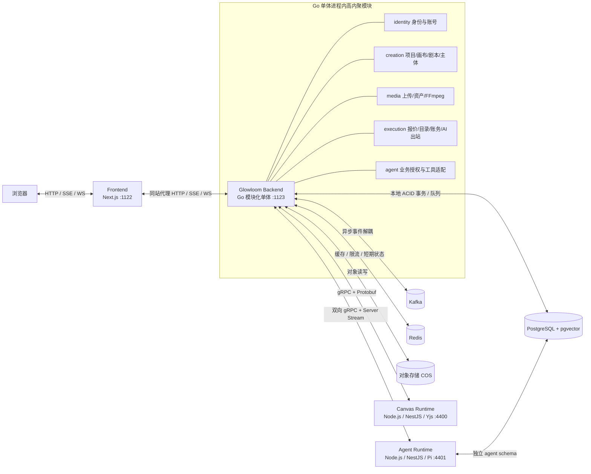

# Go 模块化单体架构与 RPC 集成设计

状态：已确认方向（RPC 方案 A 与保留 Kafka 已由 `SRC-GO-MONO-02` 确认）。唯一需求来源：[需求32：Go模块化单体架构改造需求](../requirement/32-Go模块化单体架构改造需求.md#src-go-mono-01)。本设计自 2026-11-25 起替代原 Go 微服务拆分设计（已清理删除，历史见 Git）；实施进度与调度仍只在 [BACKLOG](../../../BACKLOG.md) 维护。

## 1. 摘要

当前项目在现阶段业务体量与团队规模下，将 Go 后端拆分为多个微服务（独立 Gateway、Creation 计算服务、Media 计算服务、四域写入权拆分与跨服务分布式围栏）带来了显著的部署、协议与一致性复杂度，属于过度设计。本设计将 Go 业务后端收敛为**遵循 Google Go 规范的模块化单体（Modular Monolith）**：

- **单一 Go 进程与二进制**：回收独立 `gateway`、`creation`、`media`、`worker`、`relay` 容器与进程，由单一 `glowloom` 单体进程统一承载公开 HTTP/SSE/WebSocket API、后台任务处理与本地媒体/文档计算。
- **本地 ACID 事务替代分布式围栏**：移除跨 Go 服务的 `WriterFence`、17 个 Go 内部微服务 `.proto` 及四套受限业务 DB 角色拆分，跨模块不变量回归单一 PostgreSQL 数据库的本地事务与行锁。
- **Go ↔ Canvas / Agent 升级为强类型 RPC**：保留 `canvas/`（Yjs）与 `agent/`（Pi Durable）两个独立 Node.js 运行时，使用 **Buf + Protobuf + gRPC** 统一跨语言远程调用（含服务端流式替代内部 SSE），消除脆弱的双向内部 OpenAPI 胶水。
- **不重复造轮子**：全面清点并替换自研基础设施与已归档依赖（移除归档的 `google/wire`，引入 `errgroup`/`semaphore`、Buf 工具链，评估以 **River** 事务队列替代自研 `taskruntime` + Outbox/Relay），保持工程简洁、稳定、可维护。

## 2. 参与者

| 参与者                | 职责                                                           |
| --------------------- | -------------------------------------------------------------- |
| 项目所有者            | 确认单体收敛范围、RPC 协议选型、开源组件替换及分阶段实施授权   |
| Go 后端维护者         | 按 Google Go 规范收敛目录与显式装配，回收微服务代码与分布式围栏 |
| Agent / Canvas 维护者 | 接入 Protobuf/gRPC 服务端与客户端，保持既有业务语义与测试通过  |
| 前端维护者            | 验证公开 `/api` 契约、SSE、WebSocket 及生成客户端零破坏        |
| 运维 / 数据库管理员   | 核对精简后的 Compose 拓扑与 `backend/db/schema.sql` 离线变更   |

## 3. 背景

### 3.1 当前架构冗余事实

基于对当前仓库（`docker-compose.yml`、`backend/`、`canvas/`、`agent/`）的核查，现状存在以下高成本冗余：

| 现状痛点                 | 实际源码与配置位置                                                               | 冗余表现                                                                     |
| ------------------------ | -------------------------------------------------------------------------------- | ---------------------------------------------------------------------------- |
| Go 进程与容器过度拆分    | `docker-compose.yml`（`gateway`、`backend`、`worker`、`relay`、`creation`、`media`） | 同一 Go 仓库拆出 6 个 Go 容器，引入额外健康检查链、内网跳数、mTLS 与多套令牌 |
| 进程内计算被强行网络化   | `backend/creation/main.go`（TXT/DOCX 提取）、`backend/media/main.go`（FFmpeg）   | 纯本地计算被包装成双向 gRPC 字节流与独立 tmpfs 容器，增加内存拷贝与故障面    |
| 分布式围栏替代本地事务   | `backend/internal/platform/writefence/`、`backend/api/proto/glowloom/*`（17 份） | 在单库 PostgreSQL 上手写四 writer 协调、epoch 围栏、跨 RPC 恢复与四套 RLS    |
| 自研轮子与归档工具并存   | `google/wire`（已归档）、自研 `taskruntime`、自研 `outbox` + Kafka `relay`       | 维护成本高；自研任务租约与 Outbox/Relay 远重于当前单体需求                   |
| Go ↔ Node 内部通信脆弱   | `agent/` 双向 OpenAPI（`oapi-codegen` + `@umijs/openapi`）、`canvas/` 裸 JSON HTTP | Yjs 二进制被迫 Base64+JSON 传输；Agent 内部契约需维护两套 OpenAPI 生成链     |

### 3.2 不可绕过的约束

1. **Google Go 规范**：所有 Go 代码继续遵循 [AGENTS](../../../AGENTS.md) 中的 Google Go Style Guide / Decisions / Best Practices 与 `adapter → application → domain` 单向依赖。
2. **唯一数据库规范**：`backend/db/schema.sql` 仍是唯一结构规范，`backend/db/data.sql` 是唯一公共种子；严禁 `migrations/` 目录、自动迁移框架与运行时 DDL。
3. **前端与公共合同不变**：浏览器仍经前端同站代理访问 `/api`、SSE 与 WebSocket；公共 OpenAPI 继续沿用 `swag` → `@umijs/openapi` 生成 `frontend/src/api/`。
4. **独立 Node 运行时保留**：`canvas/`（Yjs 协作核心与共享编辑器）与 `agent/`（Pi Durable 运行时）的语言与状态所有权不变，Go 不重写 Yjs 或 Pi，不监督 Node 进程。

## 4. 目标

### 4.1 设计目标

- 将 Go 后端收敛为单一可执行程序、单一容器镜像与单一 `go.mod`，内部以高内聚业务模块隔离职责。
- 彻底清理 Go 内部微服务拆分产生的冗余入口、代理、计算 RPC、分布式围栏与 17 份内部微服务 proto。
- 建立清晰、强类型、支持流式的 Go ↔ Canvas 与 Go ↔ Agent RPC 协议（基于 Buf + Protobuf + gRPC）。
- 用成熟稳定的开源组件替代自研基础设施与已归档工具，降低代码量与运维复杂度。

### 4.2 非目标

- 不将 `canvas/`、`agent/` 或 `workspace/` 重写为 Go。
- 不改变既有产品功能范围、页面交互（[DESIGN](../../../DESIGN.md)）或前端公开 `/api` 语义。
- 不在本次文档阶段直接修改源码、数据库结构或执行线上部署。

## 5. 使用场景

| 场景                 | 触发与路径                                          | 必须保持的结果                                                  |
| -------------------- | --------------------------------------------------- | --------------------------------------------------------------- |
| 前端常规 API 与流式  | 浏览器 → Frontend 同站代理 → Go 单体（HTTP/SSE/WS） | 少一跳 Gateway 转发；鉴权、Cookie、CSRF、幂等与流式背压完全一致 |
| 跨模块强一致业务写入 | 报价确认、项目创建、账号撤权、素材上传与引用保护    | 同一 PostgreSQL 本地事务完成，不再需要跨服务围栏与两阶段协调    |
| 画布协作候选计算     | Go 单体（WS 收到编辑）→ gRPC → Canvas 运行时        | Yjs 二进制通过 Protobuf `bytes` 零 Base64 传递，支持 deadline   |
| 创作 Agent 执行与流式 | Go 单体 ↔ 双向 gRPC ↔ Agent 运行时                  | 强类型会话/控制/业务工具调用，服务端流式替代内部 HTTP SSE       |
| 后台异步任务处理     | 文档导入、媒体规范化、模型出站、邮件发送            | 单体内有界并发执行，事务型入队保证“业务写成功则任务必可见”      |

## 6. 价值

- **部署大幅简化**：应用容器从 10 个缩减至 5 个（`frontend`、`backend`、`canvas`、`agent`、`workspace`），显著降低内存占用与启动排障成本。
- **一致性大幅增强**：回归 PostgreSQL 单库 ACID 事务，消除分布式围栏、跨 RPC 丢 ACK 恢复与四套受限角色维护负担。
- **跨语言通信更健壮**：Go 与 Canvas/Agent 共享唯一 `.proto` 契约源，编译期校验接口一致性，天然具备超时、取消、流式与二进制传输能力。
- **研发效率提升**：减少自研基础设施维护，开发者聚焦核心创作、画布、AI 网关与 Agent 业务。

## 7. 方案

### 7.1 目标拓扑与职责划分



| 服务        | 技术栈                 | 唯一职责                                                     | 通信方式                           |
| ----------- | ---------------------- | ------------------------------------------------------------ | ---------------------------------- |
| `frontend`  | Next.js / React / TS   | 界面呈现、同站代理、消费 `@glowloom/canvas/editor`           | 对外 HTTP/WS/SSE；对内直连 `backend` |
| `backend`   | Go 模块化单体          | 全部核心业务权威、认证授权、计费、媒体/文档处理、后台任务    | 对外 HTTP/SSE/WS；对 `canvas`/`agent` 走 gRPC |
| `canvas`    | Node.js / NestJS / Yjs | 无状态 Yjs 候选合并与投影计算（无 DB 访问）                  | gRPC Server（`:4400`）             |
| `agent`     | Node.js / NestJS / Pi  | Agent 会话、规划、子 Agent 与恢复执行（独立 `agent` schema） | gRPC Server（`:4401`）+ gRPC Client 调 Go |
| `workspace` | Next.js / Fumadocs     | 项目知识库阅读与搜索（`:1130`）                              | 独立静态/预渲染站点                |

### 7.2 清理的微服务冗余清单

实施改造时，以下微服务过渡产物将按阶段有序移除（不保留兼容双轨或空壳目录）：

1. **独立网关层**：移除 `backend/gateway/`（`main.go`、`app/`、`proxy/`、`Dockerfile`）及 Compose 中的 `gateway` 服务；`backend` 直接监听公开端口 `1123`（容器内 `8080`），前端 `GLOWLOOM_BACKEND_ORIGIN` 直指 `http://backend:8080`。
2. **独立 Go 计算微服务**：
   - 移除 `backend/creation/main.go`、`creation/app/`、`creation/Dockerfile` 及 Compose `creation` 服务；TXT/DOCX 提取直接由进程内 `creation/document` 包调用，配 `semaphore.Weighted` 控制并发上限。
   - 移除 `backend/media/main.go`、`media/app/`、`media/Dockerfile` 及 Compose `media` 服务；WebM→H264 MP4 规范化由进程内 `media/processing` 调用本地 FFmpeg，配 `semaphore.Weighted` 与受控临时目录。
3. **Go 内部微服务协议与分布式围栏**：
   - 移除 `backend/api/proto/glowloom/{coordination,creation,execution,identity,media}/` 下全部 17 份 Go-to-Go 微服务 `.proto` 及对应 `backend/internal/contract/gen/` 生成物。
   - 移除 `backend/internal/platform/writefence/`、`backend/internal/platform/artifactrpc/` 及跨服务四 writer 协调代码。
   - 收敛数据库运行角色：单体回归统一受控应用角色（仍禁止 DDL 权限，保留 `agent` 独立受限角色），清理 `schema.sql` 中仅为四域微服务拆分的跨服务围栏表与四角色 RLS（离线更新 `schema.sql`，遵循无运行时 DDL 规范）。
4. **独立角色容器**：Compose 中移除独立的 `worker`、`relay` 服务容器；单体默认以完整模式启动（内置 HTTP Server + 内部 gRPC Server + 后台任务 Worker），保留显式运维子命令（如 `identity`、`storage`、`partitions ensure`）。

### 7.3 遵循 Google Go 规范的模块化单体目录结构

遵循 [Google Go Style Guide](https://google.github.io/styleguide/go/guide)、[Style Decisions](https://google.github.io/styleguide/go/decisions) 与 [Go Modules Layout](https://go.dev/doc/modules/layout) 的核心原则：**清晰、简单、高内聚、消费方定义小接口、显式装配、不过度分层**。

```text
backend/
  go.mod / go.sum
  Dockerfile                        # 唯一 Go 单体镜像（含运行时所需 FFmpeg）
  buf.yaml / buf.gen.yaml           # Buf 协议检查与多语言（Go + TS）生成配置
  api/
    proto/glowloom/
      canvas/runtime.proto          # Go -> Canvas RPC 契约
      agent/runtime.proto           # Go -> Agent RPC 契约（含 Server Streaming）
      agent/business.proto          # Agent -> Go RPC 契约
  cmd/
    glowloom/
      main.go                       # 唯一薄入口：解析参数、加载配置、信号处理、启动 App
  internal/
    app/                            # 单体组合根：纯 Go 显式构造函数装配（移除 Wire）
      app.go                        # 统一生命周期（errgroup 管理 HTTP / gRPC / Worker）
      router.go                     # Gin 路由注册与中间件
      grpc_server.go                # 供 Agent 回调的内部 gRPC Server 装配
    platform/                       # 薄基础设施封装（仅包装开源稳定库，不含业务规则）
      config/                       # 强类型环境变量配置
      db/                           # PostgreSQL (pgx/GORM) 连接池
      redis/                        # Redis 连接
      storage/                      # 腾讯 COS 对象存储客户端
      queue/                        # River 事务任务队列装配（待确认）
      telemetry/                    # zap/slog + OpenTelemetry (HTTP/gRPC/DB)
      rpcauth/                      # gRPC 内部服务令牌与 TLS 拦截器
    gen/                            # Buf 生成的 Go Protobuf/gRPC 代码（唯一生成目录）
    identity/                       # 账号、认证、会话、平台权限、邮件
      domain/ application/ adapter/
    creation/                       # 空间、团队、项目、画布、剧本、设定、主体、提示词、文档提取
      workspace/ canvas/ script/ bible/ subject/ prompt/ document/
    media/                          # 上传、资产、引用保护、媒体工具、FFmpeg 规范化
      domain/ application/ adapter/ processing/ mediatool/
    execution/                      # 报价、AI 统一网关、模型目录、计费钱包、执行任务
      operation/ catalog/ billing/ gateway/
    agent/                          # Go 侧 Agent 业务授权、工具执行与 gRPC 客户端/服务端适配
      domain/ application/ adapter/
    analytics/                      # 创作与经营分析读模型
    audit/                          # 审计记录
  db/
    schema.sql                      # 唯一 PostgreSQL 结构规范
    data.sql                        # 唯一公共种子数据
  tests/                            # 集中测试（单元、集成、边界门禁）
```

Google Go 关键工程落地点：

1. **目录私有性由工具链强制**：所有业务包迁入 `backend/internal/`（保留集中 `backend/tests/` 处于 `backend/` 子树内，因此 Go 工具链天然允许 `backend/tests` 导入 `backend/internal/...`，同时杜绝仓外误依赖）。
2. **严格单向依赖**：业务模块内部维持 `adapter → application → domain`，`domain` 零外部框架依赖（不导入 Gin、GORM、Protobuf 生成物）；跨模块协作只通过**消费方定义的小接口**并在 `internal/app` 组合根注入，或在同一事务中通过明确端口协作，禁止循环导入。
3. **显式装配替代 Wire**：`github.com/google/wire` 已于 2025-08-25 官方归档，单体组合根改为清晰的纯 Go 构造函数装配，按领域拆分为 `wireIdentity`、`wireCreation`、`wireMedia`、`wireExecution`、`wireAgent` 等模块装配函数，可读性更高且零代码生成负担。
4. **并发与生命周期收敛**：进程内 HTTP Server、内部 gRPC Server、后台 Worker 全部由 `golang.org/x/sync/errgroup` + `signal.NotifyContext` 统一管理所有权、取消信号与优雅停机超时，禁止失控野 goroutine。
5. **错误与上下文**：错误显式包装（`fmt.Errorf("...: %w", err)`）保留 `errors.Is`/`errors.As` 判定链；`context.Context` 贯穿 HTTP/gRPC/DB/Worker 全链路，不存入结构体字段。

### 7.4 Go 单体与 Canvas / Agent 的 RPC 集成设计

#### 7.4.1 RPC 协议与工具链选型（已确认：方案 A）

已由 [SRC-GO-MONO-02](../requirement/32-Go模块化单体架构改造需求.md#src-go-mono-02) 确认采用 **方案 A（标准 gRPC + Protobuf + Buf）**：

- **Go 侧**：复用仓库已有的 `google.golang.org/grpc` + `google.golang.org/protobuf` + 官方 `otelgrpc` 拦截器。
- **Node.js / NestJS 侧**：采用 NestJS 官方 `@nestjs/microservices`（gRPC 传输层）+ `@grpc/grpc-js` + `ts-proto`，与现有 NestJS 依赖注入与生命周期无缝集成。
- **原生优势**：原生 HTTP/2 服务端流式（`StreamRunEvents`）、Protobuf 原生 `bytes` 传输 Yjs 二进制、内置 deadline 与取消传播，配套 `grpcurl` 与 Buf 工具链。

**统一契约生成链（Buf）**：
- 在 `backend/`（或仓库根目录）维护唯一 `buf.yaml` + `buf.gen.yaml`。
- 一条 `buf generate` 命令同时生成：
  - Go 服务端/客户端桩代码 → `backend/internal/gen/`
  - Canvas TypeScript 类型与服务端接口 → `canvas/src/rpc/generated/`
  - Agent TypeScript 类型与服务端/客户端接口 → `agent/src/rpc/generated/`
- CI 通过 `buf lint`、`buf breaking` 和生成物一致性检查，彻底替代现有 `agent/` 与 `backend/` 之间脆弱的双向 OpenAPI（`oapi-codegen` + `@umijs/openapi`）内部胶水；**对外前端仍保留 `swag` → `@umijs/openapi` 链不变**。

#### 7.4.2 Go ↔ Canvas RPC 合同（`glowloom.canvas.CanvasRuntime`）

将当前 `canvas/src/http/app.ts` 的 4 个内部 HTTP POST 接口升级为 gRPC Unary RPC：

| RPC 方法     | 请求核心字段                                                | 响应核心字段                                    | 优势                                             |
| ------------ | ----------------------------------------------------------- | ----------------------------------------------- | ------------------------------------------------ |
| `Initialize` | `document_id`, `epoch`, `snapshot_json`                     | `state_bytes`, `projection_json`                | Yjs 初始状态直接走 Protobuf `bytes`，无 Base64 膨胀 |
| `Prepare`    | `document_id`, `epoch`, `writer_term`, `commit_seq`, `base_state_bytes`, `update_bytes`, `update_id`, `update_hash` | `merged_update_bytes`, `derived_update_bytes`, `projection_json`, `definitive_error` | 强类型字段校验 + 16MiB 有界消息 + 自动超时取消   |
| `Rename`     | `document_id`, `epoch`, `base_state_bytes`, `title`         | `update_bytes`, `projection_json`               | 统一错误处理与并发上限控制                       |
| `Commands`   | `document_id`, `epoch`, `base_state_bytes`, `commands_json` | `update_bytes`, `projection_json`               | 保持无状态纯计算边界，不引入 DB 依赖             |

- 健康检查采用标准 `grpc.health.v1.Health`（配合 `grpc-health-probe` 或轻量 HTTP `/healthz`）。
- 认证采用 gRPC Metadata `authorization: Bearer <GLOWLOOM_COLLAB_RUNTIME_TOKEN>`，通过统一 Interceptor/Guard 在请求解码前校验。

#### 7.4.3 Go ↔ Agent 双向 RPC 合同

1. **Go → Agent（`glowloom.agent.AgentRuntime`，Agent 作为 gRPC Server，端口 `4401`）**：
   - 会话管理：`CreateSession`、`ListSessions`、`GetSession`、`UpdateSession`
   - 运行与控制：`CreateRun`、`ListRuns`、`GetRun`、`SubmitControl`、`GetSubmission`、`ListMessages`
   - **事件流（Server Streaming）**：`StreamRunEvents(StreamRunEventsRequest { session_id, run_id, last_event_id }) returns (stream RunEvent)`
     - 替代内部 HTTP SSE；客户端断开或 Go 上游取消时，HTTP/2 Stream RST 自动通知 Agent 停止订阅，天然具备流控背压。
     - Go 单体对外（浏览器）仍将 gRPC Stream 转为标准 HTTP SSE，前端协议零变化。

2. **Agent → Go（`glowloom.agent.AgentBusiness`，Go 单体暴露内部 gRPC Server，如内网端口 `9090`，不对外映射宿主端口）**：
   - 鉴权与 Grant 校验：`VerifyRunGrant`、`AuthorizeToolCall`
   - 模型网关出站：`InvokeModel` / `StreamModel`（流式输出直接走 Server Streaming）
   - 业务工具与只读上下文：`ReadProjectContext`、`ExecuteCreationTool`、`QueryMediaReference`、`ReportUsage`
   - 认证与隔离：继续分离 `GLOWLOOM_AGENT_SERVICE_TOKEN`（Go→Agent）与 `GLOWLOOM_AGENT_BUSINESS_TOKEN`（Agent→Go），非 local 环境启用 TLS/mTLS；W3C Trace Context 通过 `otelgrpc` 自动透传。

### 7.5 不重复造轮子：开源稳定组件库与工具集选型

本节遵循“优先成熟稳定、社区活跃、与现有栈契合的开源组件，杜绝自研轮子与重复框架”原则：

| 能力领域         | 当前自研 / 冗余实现                                   | 推荐开源稳定组件与工具集                                                   | 选型理由与取舍                                                         |
| ---------------- | ----------------------------------------------------- | -------------------------------------------------------------------------- | ---------------------------------------------------------------------- |
| **依赖注入**     | `github.com/google/wire`（已于 2025-08-25 归档）      | **纯 Go 显式构造函数装配**                                                 | 符合 Google Go 规范，零生成代码、编译期类型安全、无归档维护风险         |
| **异步事件解耦** | 独立 Kafka `relay` 容器 + 跨服务四域 Outbox 表                                 | **已确认保留 Kafka（`twmb/franz-go`）**，收归单体进程内 `errgroup` 后台协程投递与消费 | 保留高吞吐异步解耦与削峰能力，同时去除独立 `relay` 容器与跨服务多角色 Outbox 复杂度 |
| **后台任务队列** | 自研 `taskruntime`（PG 租约/心跳/抢占/重试）                                   | **建议：River**（`github.com/riverqueue/river`, Apache-2.0, 基于 `pgx/v5`）            | 与业务共享同一 PostgreSQL 事务 `InsertTx`，开箱提供幂等唯一键、退避重试、并发控制与优雅停机，替代自研调度轮子（与 Kafka 分工互补：River 管可靠后台作业，Kafka 管领域事件解耦） |
| **跨服务 RPC**   | 17 份内部微服务 proto + Agent 双向 OpenAPI + Canvas JSON HTTP | **Buf CLI** + **gRPC-Go** + **NestJS `@nestjs/microservices` (`@grpc/grpc-js`)** + **`ts-proto`** | 单一 `.proto` 源驱动 Go/TS 双端生成，内置 `lint`/`breaking` 门禁，支持流式与二进制 |
| **HTTP 框架**    | `gin` + 自研独立 `gateway` 反向代理                   | 保留 **`gin`** + 标准 **`net/http.Server`** + **`swag`**（移除 `gateway`） | 保留现有 Handler 与前端 `openapi2ts` 生成链，零前端破坏                 |
| **数据库访问**   | `gorm` + `pgx/v5`（四角色 RLS + 分布式围栏表）        | 保留 **`gorm` / `pgx/v5`** + 唯一 **`schema.sql`**                         | 回归单库本地事务，不引入自动迁移框架，避免全量重写数据访问层           |
| **并发与限流**   | 手写 goroutine / WaitGroup / 简单通道控制             | **`golang.org/x/sync/errgroup`**、**`semaphore`**、**`golang.org/x/time/rate`** | Go 官方扩展库，彻底收敛 goroutine 生命周期与 FFmpeg/文档解析并发上限   |
| **重试与熔断**   | 零散手写重试逻辑                                      | **`github.com/cenkalti/backoff/v5`**（已在 `go.mod`）、按需 **`sony/gobreaker`** | 统一外部 AI 供应商与 RPC 的有界指数退避与过载保护                      |
| **日志与观测**   | `go.uber.org/zap` + OpenTelemetry                     | 保留 **`zap`**（或逐步对齐标准库 **`log/slog`**）+ 官方 **`OpenTelemetry`**（补齐 `otelgrpc`） | 统一 HTTP、gRPC、DB、队列全链路 Trace 与结构化日志                     |
| **对象存储**     | `tencentyun/cos-go-sdk-v5`                            | 保留官方 SDK                                                               | 稳定直连，无须额外抽象                                                 |
| **缓存与锁**     | `redis/go-redis/v9`                                   | 保留官方客户端                                                             | 仅用于缓存、限流与短期协调，不替代 PG 业务权威                         |
| **WebSocket**    | `github.com/coder/websocket`                          | 保留                                                                       | 现代标准库风格、支持 Context 与并发安全                                |
| **校验与测试**   | `validator/v10`、`testify`、`golangci-lint`、`govulncheck` | 保留并统一由 CI 固定版本执行                                               | 保障 Google Go 编码质量与依赖安全                                      |

> [!NOTE]
> **Kafka 与后台任务队列的分工（已确认）**：按 `SRC-GO-MONO-02` 确认保留 Kafka 作为异步事件解耦能力（使用现有成熟 Go 客户端 `twmb/franz-go`），事件投递/消费作为单体内部受 `errgroup` 管理的协程运行，不再维护独立 `relay` 容器；长耗时的后台作业（文档导入、媒体处理、模型轮询等）由事务型任务队列（建议 River）承担，职责清晰且不重复造轮子。

### 7.6 精简后的部署与开发拓扑

- `docker-compose.yml` 应用服务收敛为 5 个：
  1. `frontend`（Next.js，宿主 `127.0.0.1:1122`，直连 `http://backend:8080`）
  2. `backend`（Go 单体，公开 HTTP 宿主 `127.0.0.1:1123 -> 8080`，内网 gRPC `9090` 仅暴露给 `agent`）
  3. `canvas`（Node.js Yjs 运行时，内网 gRPC `4400`）
  4. `agent`（Node.js Pi Durable 运行时，内网 gRPC `4401`）
  5. `workspace`（Fumadocs 知识库，宿主 `127.0.0.1:1130`）
- 移除 `gateway`、`creation`、`media`、`worker`、`relay` 五个冗余容器及其专属环境变量（`GLOWLOOM_GATEWAY_*`、`GLOWLOOM_CREATION_EXTRACTION_*`、`GLOWLOOM_MEDIA_NORMALIZATION_*`）。

## 8. 实施与验收

### 8.1 分阶段演进门禁

| 门禁             | 必须证明的条件                                                                      | 对应需求验收 |
| ---------------- | ----------------------------------------------------------------------------------- | ------------ |
| G-GOMO-01 文档   | 需求32 → 设计47 → PRD33 → Plan42 及导航完整贯通，旧微服务文档明确标注替代且保留历史 | AC-GOMO-01   |
| G-GOMO-02 单体收敛 | `gateway`、`creation`、`media` 独立入口与容器移除；全后端单一二进制构建与启动通过   | AC-GOMO-02   |
| G-GOMO-03 事务回归 | `writefence` 与 17 份内部微服务 proto 移除；报价、撤权、上传引用回归本地 PG 事务    | AC-GOMO-05   |
| G-GOMO-04 RPC 集成 | Buf 生成链在 CI 通过；Go ↔ Canvas 与 Go ↔ Agent 均经真实 gRPC 与流式测试验收        | AC-GOMO-03   |
| G-GOMO-05 规范门禁 | `gofmt`、`go vet`、`golangci-lint`、`go test -race`、`govulncheck` 与前端生成链全绿 | AC-GOMO-04   |

### 8.2 最小技术验证场景

| ID           | 前置与动作                                         | 可观察接受结果                                                      |
| ------------ | -------------------------------------------------- | ------------------------------------------------------------------- |
| CASE-GOMO-01 | 单一 `glowloom` 进程启动，经 `1123` 访问公开 `/api` | 认证、Cookie、CSRF、幂等、SSE、WebSocket 与改造前合同完全一致       |
| CASE-GOMO-02 | 上传 WebM 视频与导入 TXT/DOCX 文档                 | 单体进程内经有界信号量完成规范化与文本提取，无独立计算容器，临时文件无泄漏 |
| CASE-GOMO-03 | 并发报价确认、账号撤权与项目关闭                   | 本地 PostgreSQL ACID 事务保证唯一预占、立即撤权生效与引用保护       |
| CASE-GOMO-04 | 画布多人并发编辑触发 Go → Canvas gRPC `Prepare`    | Protobuf 二进制更新正确合并并投影；超时取消能及时释放服务端计算槽   |
| CASE-GOMO-05 | 发起创作 Agent 对话并中途取消/断线重连             | Go ↔ Agent 双向 gRPC 与 Server Streaming 正常推进，断连不泄漏订阅   |
| CASE-GOMO-06 | 业务写入后模拟进程重启（异步任务恢复）             | 事务型队列确保已提交业务对应的异步任务可靠恢复且不重复扣费          |
| CASE-GOMO-07 | 运行全量依赖方向门禁与 `golangci-lint`             | 零反向依赖（`domain` 零框架/Proto 依赖）、零 Wire 残留、lint 0 issues |
| CASE-GOMO-08 | 解析并启动精简后的 5 服务 Docker Compose           | 无健康依赖环，无废弃容器与环境变量，前端 `1122` 端到端可用          |

具体任务拆解与验证步骤见 [PRD33](../prd/33-Go模块化单体架构改造.md) 与 [Plan42](../plan/42-Go模块化单体架构改造执行计划.md)。

[原始需求32](../requirement/32-Go模块化单体架构改造需求.md) · [技术设计导航](00-设计导航.md) · [知识库索引](../index.mdx)
