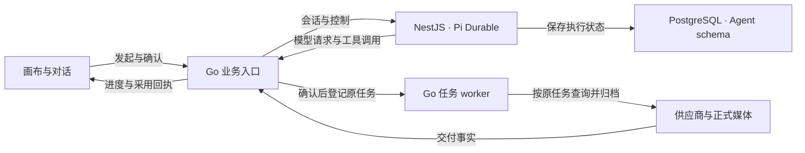

# 完整创作 Agent 服务能力与交付路线调研

> **已归档 / 历史调研（2026-11-25）**：本文基于 NestJS / Pi Durable / Prisma 历史路线，已移出默认搜索；现行 Mastra 架构选型与重构路线请见 [研究71](71-2026-11-25-Agent服务架构网关与评测技术选型调研.md) 与 [设计48](../design/48-Agent服务Mastra架构与技术选型设计.md)。

调研日期为 2026 年 11 月 23 日。代码复核基线为 `22b7fe4e6`，包含项目共享约定 `37a82487b`、项目证据检索 `2a4ee2c55` 和 Agent 职责重组。本文补充执行、授权、作品交付和上线接受依据。产品行为沿需求20、设计35与 Plan31，执行合同沿设计32、设计37与 Plan28，任务状态以 BACKLOG 为准。[代码基线][baseline] · [设计32][design32] · [设计37][design37] · [Plan28][plan28] · [Plan31][plan31] · [BACKLOG][backlog]

## 1. 结论

**沿用现有 Agent 服务，优先确定普通故事板的写入归属和稳定镜头身份，再用同一镜验证创意、改稿、报价、制作、回看与采用。** Go 负责身份、项目、模型出站、工具、预算和正式作品。NestJS 服务用 Pi Durable 运行主 Agent 与受限子 Agent，用 Prisma、Kysely 和受限 PostgreSQL schema 保存执行状态。两端通过稳定身份和原回执收敛。数据库结构沿 `backend/db/schema.sql`，新库由该文件初始化，存量库由管理员在发布前离线核验和受控变更。[设计32][design32] · [设计37][design37] · [规范性 schema][db-schema]

已具备持久执行、控制围栏、项目记忆、词法证据检索与剧本索引的源码基础。普通故事板仍缺统一的镜头身份、修订与正式写入合同。现有隔离单镜交付基于画布节点，采用会触发时间线和导出，还要求任务没有 `RowID`。该证据可以验证生成与资金的复用方向，普通故事板必须实测镜头绑定、用户采用与页面回读。T-CONV-15 是普通画布后续任务的依赖。[任务状态][storyboard-backlog] · [既有单镜工具][shot-delivery] · [隔离单镜用例][shot-test]

完整服务还需要按现有计划验证可恢复的专业分支、受权 Skill、正式 MCP、运维与评测。首版站内单镜依赖授权控制、正式写链和任务恢复。向量、重排、专业分支并行和外部 MCP 由各自的采纳门槛决定，已有词法和项目约定可以支持首版联调。[Plan28 R4～R7][plan28] · [检索选型和评测](69-2026-11-23-创作Agent上下文与检索技术选型和评测.md) · [研究67](67-2026-11-23-画布AI对话与故事板竞品调研.md)

## 2. 当前能力和接受条件

| 能力 | 基线中可复核的实现 | 完整服务需要的证据 |
| --- | --- | --- |
| 执行与合同 | Nest HTTP/SSE、DTO 校验、双向生成合同、Pi Durable 1.5.0、PostgreSQL Storage。保存 session、run、原 submission、拥有的子会话和已提交事件。生产 JS 入口与 Storage conformance 有既有验证入口。[Nest 装配][http] · [Storage][storage] · [官方合同测试入口][conformance] | 实际运行版本、镜像和定义摘要一致。隔离双实例、失租约及未知提交时，只有当前 owner 能提交，活动旧定义可清结 |
| 授权与收款 | Go 维护 grant、控制决定、原调用回执、目标与费用投影。已有确定性制作受理和原任务引用。[Go 权威与回执][go-authority] · [根费用投影][cost] · [制作完成判定][goal] | 报价变化失效、并发批准、丢响应和恢复均可用原身份对账。核对原供应商下单次数、有效预留和账本扣款。独立证明真实供应商与用户计费 |
| 控制与恢复 | Go 控制决定及可靠投递，Agent 处理执行收束及 continuation。等待交付查询业务快照，恢复泵扫描可领取项。仓库有进程 SIGKILL 和事件合同用例。[控制投递][control-go] · [执行收束][controls] · [交付等待][delivery] · [恢复泵][recovery] · [进程恢复用例][process-test] | 将掉线、进程退出、未知业务提交、主动暂停和 Stop 分开演练。控制无空窗，等待释放执行槽，恢复使用原截止和身份，重连可回到已提交事实 |
| 上下文、RAG 与项目约定 | 按模型调用冻结业务快照并预检上下文。Go 维护项目约定发布、更正及撤回。项目证据按稳定 ID、词法或别名搜索，读取当前版本，已采用剧本通过现有 worker 入索引。已用证据回执保留在本对话，Go 出站再验证来源。[模型适配器][model] · [项目上下文][project-context] · [共享约定][memory] · [证据与索引][evidence] | 用真实授权项目语料测来源覆盖、新鲜度和跨会话连续性。切实验证镜头修订、过期来源、动态授权、索引晚到和上下文裁剪。未做语义向量及生产时延测量。[上下文研究](68-2026-11-23-AgentHarness上下文记忆与RAG能力调研.md) · [评测基线](69-2026-11-23-创作Agent上下文与检索技术选型和评测.md) |
| Tool、Skill 和专业 Agent | Go 发布工具描述、效果与合同，Pi 按角色注册，已有 `skill_load`、冻结 Skill 资源与 `delegate`。主 Agent 有独立上下文的 owned child，并按边界限制角色、工具和任务预算。[工具注册][registry] · [已选 Skill][skills] · [委派边界][delegation] · [冻结清单][manifest] | 验证实际分支运行重叠、兄弟失败隔离、原分支复用、根额度并发竞争、受权自动 Skill 选择、依赖闭包和撤权。正式 MCP 连接、凭据、工具变更和原远端回执沿 R6 接入 |
| 故事板与作品 | 普通画布已有助手；现有 `/storyboard` 页面转至短剧分集。Prompt 已定义 `storyboard-plan/v3`；Go 有画布节点交付、媒体查询和工程导出机制。[画布入口][canvas] · [当前分镜入口][storyboard-route] · [分镜 Schema][storyboard-schema] · [既有单镜工具][shot-delivery] | 落定普通故事板身份和写入方，验证允许无分集。以正式镜头及修订串起来布局、回读、局部编辑、原任务、候选和采用。短剧原路径单独回归 |
| 观测与评测 | Go 有 OTLP 连接；Agent 的 `PhaseTelemetry` 传递 Pi 任务和模型阶段的关联元数据。项目仓库有合同、恢复和隔离模型回归，已有检索离线试验。[Go OTLP][otel-go] · [Pi 阶段元数据][pi-telemetry] · [验证记录][backlog] | 贯通跨进程追踪、等待与对账指标。固定版本的创作评测复验业务终态与创作者实际体验。隔离通过、浏览器闭环、真实供应商和投产准备分别留证 |

项目记忆与 RAG 行采用 37a82487b、2a4ee2c55 后的新事实。仓库记录 RAG 隔离验收覆盖跨项目同名、版本变更、来源删除、转写时间窗和旧索引任务晚到，Agent 当轮为 34 个测试文件、201 项。重组后的独立验证为 34 个测试文件、202 项，并以实际生产 JS 入口在隔离环境走查启动和服务合同。两轮模型和媒体证据均来自受控条件。生产环境在途运行、真实语料及供应商接受仍需独立留证。本文复核源码、既有证据和官方资料，未另起业务环境执行测试。[本地与隔离证据记录][backlog] · [当前代码][baseline]

## 3. 一次创作如何形成可采用的作品

以下以渡轮为示例。镜头数量、时长、选用模型和费用由实际简报与报价决定。产品决策来自 FR-CONV-15～17，涉及普通板数据归属和写入合同的细节由 T-CONV-15 确认。[用户确认][requirements] · [设计35 §7.11][design35] · [Plan31][plan31]

| 用户动作 | Agent 怎样推进 | Go 和界面以何为准 |
| --- | --- | --- |
| 在空白画布说「我想拍清晨第一班渡轮」 | 给少量差异明确的方向，比如乘客观察、码头人物或从海雾中揭示环境。解释叙事和制作取舍，结合简报推荐。用户可选、组合或补充 | 此时显示创作提议。媒介生成提交数为零，用户可以继续讨论 |
| 用户明确要求「乘客视角的观察短片，直接分镜」 | 直接生成符合结构的镜头草案。只问素材或只聊创意时保持相应对话。遇到会改变目标或指定对象的冲突才请求确认 | 结构和领域约束通过后通过正式工具写入。用户可重开故事板。新增、改序与修订有原回执 |
| 用户打开故事板，把当前第二镜加入对话，只改成握住栏杆的手 | 用选中时解析的镜头身份和修订生成针对字段的修改。项目素材与镜头都可精准引用，优先读取用户明确指定的版本 | 默认显示镜头，可切项目素材。多人重排仍定位原镜；同字段冲突展示差异。其他手改字段、素材及已采用版本保留 |
| 用户只为这一镜取价并确认 | 按当前镜头与授权来源准备生成。等待显式确认，再交已冻结的目标和参数 | Go 冻结候选身份、镜头及来源修订、模型、规格、价目与报价有效期。确认复验并一次受理。改稿、引用、模型或价格变化时重新报价。缺可用视频模型时仍可继续改板 |
| 等待样片，中途断线再打开 | 查询原镜头绑定的原 operation 和回执。等待状态有截止与再查计划，进程重开按原 ID 收敛 | 回看正式任务的排队、处理、可预览、待核对或失败。正式媒体可授权播放后显示候选。任务成功本身保持候选状态 |
| 预览后采用，或重新制作 | 用户显式选择采用。重做按本镜新候选发起新报价，用户仍可查看旧候选 | Go 校验当前镜头、候选来源、媒体可读和修订，再写采用回执。故事板与画布回读同一素材版本，刷新保持该关系。经批准的完成义务逐项读权威回执 |

**故事板归属的决定依据。** 普通画布可无分集。用现有创作域和画布的实际读写合同做这组验证：正式镜头可长期定位，顺序独立于身份，写入支持版本竞争和字段合并边界，画布与故事板能回读同一采用结果，短剧仍使用已有制作身份。Go 负责对外授权和正式提交，Agent 负责草案与调用。选择唯一正式写入口并让另一个工作面读取该结果或其投影。以固定草案同时验证首次写入重放、两个协作者改序和同字段更新，再接模型。沿用既有 Operation 与媒体资产身份，核清当前 `RowID` 限制、时间线/导出副作用后再决定现有采用命令的复用范围。[设计35][design35] · [既有单镜工具][shot-delivery] · [Plan31][plan31]

## 4. 中断、控制与权限的判定

| 场景 | 采取的动作 | 可查证的通过条件 |
| --- | --- | --- |
| 浏览器断线、事件重复或游标失效 | 从已提交游标续读并去重。游标失效重取当前会话、原 run、待审批或任务快照，再订阅。始终读取当事人的会话 | SSE 断开只收订阅；恢复后运行和作品状态一致，新增 run、模型调用和媒体提交均为零。协议游标是传输进度，业务状态来自回执。[SSE 标准][sse-spec] · [公开事件读取][public-events] |
| Go 提交后响应丢失、Agent 崩溃或供应商超时 | 原受理、模型或工具凭同一身份与内容哈希查询。远端已知任务查原任务，接单未知保留原预留和待核对；只有验证过远端幂等的原调用才允许同键重试 | 重复确认和接管复用原请求、operation 与预留。同键异参被拒。远端一次受理、账本最多一次有效扣款；有两份明确批准的新旧候选时，两份费用可分别追溯 |
| Pause、审批及显式 Resume | Go 先提交当前控制决定与 `authorization_revision`，可靠投递。Agent 收束原执行段，安全保存并释放槽；显式接续使用由决定派生的 continuation 身份 | 审批或暂停生效后新模型和写工具准入封闭。迟到消息仅按当前版本收敛。Resume 在原 root 下开启确定性新段，已经接受的外部请求只收原回执 |
| Stop、项目或素材撤权 | Go 先撤销该范围授权，拒绝后续新外呼；Agent 收束同树子任务。重连和接管重验当前身份、资料与控制版本；已发送远端请求按其实际终态对账 | 旧 owner、旧审批和旧来源均不能恢复新的出站。取消已请求和已终止分别显示。过期证据、记忆旧版或不可读引用不会随历史摘要继续发给模型，必要时引导以当前资料开新会话 |
| 作品与账务暂未收敛 | 等待记录持有原 refs、首次等待、绝对截止和唤醒。对账检查原操作、正式媒体及目标义务，按暂时失败、未知或不可恢复分类 | 进程重启不延长截止或重发费用。草案、执行回合结束、可播放、已采用与业务完成各自可验证。夹具故障后硬断言数据库与账本终态 |

控制围栏与 Pi 调度各自持久化。Pi v1.5.0 的工具调用意图先于执行提交，只有标为 replay-safe 的中断工具才会重跑，且有重启上限。Go 的原调用查询和业务幂等覆盖它负责的提交边界；无可靠远端查询或幂等能力时保持待核对。PostgreSQL 提交结果未知时封闭旧执行窗口，接管后先查询已提交前缀。用 DB 时钟、租约 epoch 和 Go grant 在各自事务内验证，跨服务网络调用有界且移出数据库事务。业务失败回执和追踪 ID 可关联。[Pi v1.5.0 README][pi] · [设计32 §7.4～7.6][design32] · [原调用存储][calls]

**主 Agent、子 Agent 与继续执行。** 主 Agent 维护目标、计划版本、待决事项和交付条件，分配有明确产物约束的任务书。先持久保存稳定分支键、owned child 标识和预算分配，再提交子任务。子 Agent 使用收窄的模型、工具、来源与预算，只提交可校验的产物和证据，由主 Agent 汇总。分支重开复用原提交和分配，父级取消传播。主 Agent 可在硬约束内自动继续已授权的计划，到审批、资料缺失、预算耗尽或不可确定的外部结果时按对应等待或失败状态收敛。等待用户及已受理外部作业时释放执行槽。专业输出经正式写入与采用流程形成项目事实。并行启用条件沿 R4 的原子划拨和真实模型在途重叠验证。[设计32][design32] · [Plan28 R4][plan28]

## 5. 成熟方案可借用的做法

| 一手来源 | 已核实的能力 | 对 Glowloom 的取舍 |
| --- | --- | --- |
| Pi Durable v1.5.0 | 保存会话、模型阶段、工具任务及应用文档；工具 replay 有明确语义；支持自定义 Storage 和 conformance。维护方将 API 标为实验性质。[官方固定版本][pi] | 保留现有源码适配和发布锁定，升级前验证 Storage、公开事件与在途执行定义。使用 Pi 已有任务、子会话和调度 |
| OpenAI Agents SDK 与 LangGraph | OpenAI SDK 可暂停工具、持久化 `RunState` 并恢复，完整快照的主体和完整性由应用校验。LangGraph 用同 thread 的 checkpoint 接续，interrupt 恢复会从原节点开头执行，跨 thread 的 Store 存应用数据。[OpenAI 审批][openai-hitl] · [LangGraph Persistence][lang-persistence] · [LangGraph Interrupts][lang-interrupts] | 采用服务端保存原审批、界面传最小授权信息、从稳定恢复点续跑的做法。继续复用现有 Pi 与 Go 的执行、项目及账本权威；引入另一套运行时会增加持久状态、发布和恢复负担 |
| Anthropic 编排与 Agent Skills 规范 | 官方将按输入动态拆解的 orchestrator-workers 适用于难以预先确定子任务的工作。Skills 规范支持按需载入指令和资源，也允许包内脚本。[编排模式][anthropic-workflows] · [Skill 规范][skill-spec] | 单镜先使用满足需求的主 Agent 与已选 Skill。复杂制作确有独立专业工作时再委派和汇总可校验产物；受权加载版本固定的资源，执行脚本由既定隔离能力及授权决定 |
| MCP 与官方 Go SDK | 初始化协商协议和能力，工具提供 schema 和列表变更通知。HTTP 授权规范要求令牌绑定目标资源且由服务端验证受众，2025-11-25 的 Tasks 为实验能力，按双方和具体工具协商。[生命周期][mcp-life] · [工具][mcp-tools] · [授权][mcp-auth] · [Tasks][mcp-tasks] · [Go SDK][mcp-go] | Go 管理连接、凭据和工具绑定，Agent 只消费冻结且受权的描述。远端注解作提示，项目权限、效果/费用与重放策略由本地合同控制。从受控只读 Streamable HTTP 验证，再按原回执能力扩到外部写入 |
| OpenTelemetry 与 Agent 评测 | GenAI Agent spans 当前为 Development；OpenAI trace grading 支持按执行轨迹评估决策、工具与输出。Anthropic 以分离的试次验证最终环境，并区分多次尝试出现至少一次成功和多次均成功。[OTel 约定][otel-genai] · [OpenAI Trace grading][openai-evals] · [Anthropic Evals][anthropic-evals] | 复用 Go OTLP，Node 保留 Pi 模型阶段关联并接跨边界 trace。先用既有测试和有版本的脱敏评测记录。质量平台的引入条件沿研究69，采样 trace 服务于排查，授权与资金继续查正式账本 |

**正式工具接入门槛。** 工具描述包含版本、效果、参数/结果 schema、授权范围、大小与超时以及原调用查询办法；授权变更即时阻断。新目录或 schema 版本供新运行评估，活动运行只接受已冻结且仍授权的版本。MCP 变更通知触发目录复核，停用连接应撤销当前准入。项目写入或外部计费调用须可根据原身份查回执或以同键幂等执行。验证远端取消的实际终态，确认是否仍在途。若工具能力不支持这些条件，只开放已验证的受权使用范围，未知结果交原单对账。[Plan28 R5～R6][plan28] · [MCP 工具与权限][mcp-tools] · [MCP 授权][mcp-auth]

## 6. 交付顺序和联合验收

下表是依据现有 Plan 和 BACKLOG 提出的验收顺序，以职责作交接。上线开关、生产额度和具名负责人由实际发布评审确定。[Plan28][plan28] · [Plan31][plan31] · [任务状态][storyboard-backlog]

| 顺位与依赖 | 牵头职责 | 出口证据 |
| --- | --- | --- |
| 确认普通故事板合同，T-CONV-15 | Go 创作域牵头，画布、Agent、Prompt 会签 | 正式读取与唯一写入方、稳定镜头和修订、可无分集、原写回执及候选/采用路由；固定草案验证幂等、重排和并发编辑，现有短剧读写回归 |
| 打通创意到可编辑故事板，T-CONV-16～20 | 画布接本人 Pi 会话和镜头/素材界面，Agent/Prompt 做意图和草案，Go 落正式内容 | 普通画布从模糊和明确两类输入都能到正式可重开板。纯讨论零生成、冲突可复核、手改与其他镜头完整。桌面和窄屏能完成回看与引用。旧对话保留原任务和产物 |
| 打通单镜制作，T-CONV-21～23 | Go 报价/Operation/计费与媒体、创作域交接，画布和 QA 联验 | 真实隔离 PG、对象存储和生产 JS，受控供应商验证重复确认、丢响应、撤权、进程恢复、播放、采用、重做旧候选保留。记录 provider 模拟接单计数、原资金与账本、镜头/候选/采用修订、浏览器回读和回归场景 |
| 真实一镜接受，T-CONV-24 | 产品、QA、计费与供应商配置负责人 | 经授权的实际可用模型和对应价格，确认后仅一次受理，可授权重播的正式视频、采用回执与实际计费核查。账单未出时费用保留待核对；可在隔离夹具验证重做 |
| 运行能力扩展，Plan28 R4～R7，评测 T-AH-EV-02/03 | Agent、Go、项目/媒体域、QA、平台运维 | 分支需证明同时在途、局部失败恢复与预算不超；Skill 验证真实选择、版本与依赖；MCP 验证真实握手、撤权和原回执。模块评测先行，产品联调消费真实普通画布结果。RAG-03 在授权语料中量化收益再定是否采用 |
| 发布就绪，每个开放切片均验 | Agent、平台运维、DBA、计费和 QA | 运行 schema/角色、服务镜像与定义摘要核对；停新受理、清结在途执行、可查询原任务和待核对资金。用隔离环境演练错版本拒绝、DB/供应商中断和重启接管，记录实测 RPO/RTO、排队与容量基线和恢复证据 |

**完整创作评测。** 用固定版本的中文简报覆盖模糊、明确、纯讨论、引用缺失或冲突、多用户编辑与来源变更，覆盖作品制作、撤权、重连、控制乱序、未知费用和恢复。每条记录保留 fixture 来源、权限、模型和执行定义、重复试次、原回执及最终作品。机器核对授权、零副作用、版本、扣费、播放和采用等硬条件。人评方向是否有差异、推荐是否有取舍、分镜是否可拍以及样片是否值得采用。对重复试次报告首轮成功率与连续成功情况。实际读到账本、原远端请求与作品而后记录通过。[研究69 评测方法](69-2026-11-23-创作Agent上下文与检索技术选型和评测.md#5-评测方法的选择) · [Anthropic Evals][anthropic-evals]

**线上判读。** 关联 request、run、submission/task、call、decision、operation 和回执，采集首个可见输出耗时、队列最老年龄、确认到首次真实供应商发送 p95、控制未投递年龄、未知预留年龄、恢复积压、授权拦截、候选至采用转化。高基数 ID 放追踪与受控日志，指标以阶段、结果和模型能力聚合。默认采集版本、耗时、计量和分类，提示词、私聊、素材和凭据保持在其授权存储。按实测容量和 SLA 定告警与开关。故障时暂停新受理并保留查询、控制与原单对账，恢复时核对旧执行者与原费用，以实测数据标记恢复结果。职责移动会影响执行定义指纹；切换时核对在途定义并按既定发布门清结，活动运行盘点以运行环境为准。[Go OTLP][otel-go] · [OTel GenAI][otel-genai] · [设计32][design32]

[baseline]: https://github.com/StephenQiu30/glowloom/tree/22b7fe4e63b2e1232e128e50d92f6108dd4f19d1
[requirements]: ../requirement/20-对话工作台与参考输入一致性需求.md#src-conv-10
[design32]: ../design/32-完整创作AgentHarness与Skill多Agent架构设计.md
[design35]: ../design/35-对话工作台与参考输入一致性设计.md#canvas-storyboard-conversation
[design37]: ../design/48-Agent服务Mastra架构与技术选型设计.md
[plan28]: ../plan/28-完整创作Agent与Skill多Agent实施计划.md
[plan31]: ../plan/31-对话工作台与参考输入一致性实施计划.md#canvas-storyboard-plan
[backlog]: https://github.com/StephenQiu30/glowloom/blob/22b7fe4e63b2e1232e128e50d92f6108dd4f19d1/BACKLOG.md#harness-module-backlog
[storyboard-backlog]: https://github.com/StephenQiu30/glowloom/blob/22b7fe4e63b2e1232e128e50d92f6108dd4f19d1/BACKLOG.md#canvas-storyboard-backlog
[db-schema]: https://github.com/StephenQiu30/glowloom/blob/22b7fe4e63b2e1232e128e50d92f6108dd4f19d1/backend/db/schema.sql
[http]: https://github.com/StephenQiu30/glowloom/blob/22b7fe4e63b2e1232e128e50d92f6108dd4f19d1/agent/src/http/app.ts
[storage]: https://github.com/StephenQiu30/glowloom/blob/22b7fe4e63b2e1232e128e50d92f6108dd4f19d1/agent/src/pi-durable/storage/postgres.ts
[conformance]: https://github.com/StephenQiu30/glowloom/blob/22b7fe4e63b2e1232e128e50d92f6108dd4f19d1/agent/tests/storage/conformance.test.ts
[go-authority]: https://github.com/StephenQiu30/glowloom/blob/22b7fe4e63b2e1232e128e50d92f6108dd4f19d1/backend/internal/agent/adapter/postgres/authority.go
[calls]: https://github.com/StephenQiu30/glowloom/blob/22b7fe4e63b2e1232e128e50d92f6108dd4f19d1/backend/internal/agent/adapter/postgres/calls.go
[cost]: https://github.com/StephenQiu30/glowloom/blob/22b7fe4e63b2e1232e128e50d92f6108dd4f19d1/backend/internal/agent/adapter/postgres/cost_projection.go
[goal]: https://github.com/StephenQiu30/glowloom/blob/22b7fe4e63b2e1232e128e50d92f6108dd4f19d1/backend/internal/app/agent/goal_completion.go
[control-go]: https://github.com/StephenQiu30/glowloom/blob/22b7fe4e63b2e1232e128e50d92f6108dd4f19d1/backend/internal/agent/adapter/postgres/conversation_control.go
[controls]: https://github.com/StephenQiu30/glowloom/blob/22b7fe4e63b2e1232e128e50d92f6108dd4f19d1/agent/src/sessions/execution/controls.ts
[delivery]: https://github.com/StephenQiu30/glowloom/blob/22b7fe4e63b2e1232e128e50d92f6108dd4f19d1/agent/src/sessions/execution/delivery.ts
[recovery]: https://github.com/StephenQiu30/glowloom/blob/22b7fe4e63b2e1232e128e50d92f6108dd4f19d1/agent/src/sessions/recovery/pump.ts
[process-test]: https://github.com/StephenQiu30/glowloom/blob/22b7fe4e63b2e1232e128e50d92f6108dd4f19d1/agent/tests/recovery-process.test.ts
[public-events]: https://github.com/StephenQiu30/glowloom/blob/22b7fe4e63b2e1232e128e50d92f6108dd4f19d1/agent/src/sessions/persistence/public-events.ts
[model]: https://github.com/StephenQiu30/glowloom/blob/22b7fe4e63b2e1232e128e50d92f6108dd4f19d1/agent/src/pi-durable/model-provider.ts
[project-context]: https://github.com/StephenQiu30/glowloom/blob/22b7fe4e63b2e1232e128e50d92f6108dd4f19d1/agent/src/pi-durable/context/project.ts
[memory]: https://github.com/StephenQiu30/glowloom/blob/22b7fe4e63b2e1232e128e50d92f6108dd4f19d1/backend/creation/workspace/adapter/postgres/project_memory.go
[evidence]: https://github.com/StephenQiu30/glowloom/blob/22b7fe4e63b2e1232e128e50d92f6108dd4f19d1/backend/internal/app/agent/evidence.go
[registry]: https://github.com/StephenQiu30/glowloom/blob/22b7fe4e63b2e1232e128e50d92f6108dd4f19d1/agent/src/pi-durable/tools/registry.ts
[skills]: https://github.com/StephenQiu30/glowloom/blob/22b7fe4e63b2e1232e128e50d92f6108dd4f19d1/agent/src/pi-durable/tools/skills.ts
[delegation]: https://github.com/StephenQiu30/glowloom/blob/22b7fe4e63b2e1232e128e50d92f6108dd4f19d1/agent/src/pi-durable/tools/delegation.ts
[manifest]: https://github.com/StephenQiu30/glowloom/blob/22b7fe4e63b2e1232e128e50d92f6108dd4f19d1/agent/src/sessions/manifest.ts
[canvas]: https://github.com/StephenQiu30/glowloom/blob/22b7fe4e63b2e1232e128e50d92f6108dd4f19d1/frontend/src/components/canvas/yjs-workspace.tsx
[storyboard-route]: https://github.com/StephenQiu30/glowloom/blob/22b7fe4e63b2e1232e128e50d92f6108dd4f19d1/frontend/src/app/storyboard/page.tsx
[storyboard-schema]: https://github.com/StephenQiu30/glowloom/blob/22b7fe4e63b2e1232e128e50d92f6108dd4f19d1/backend/creation/prompt/domain/builtin.go
[shot-delivery]: https://github.com/StephenQiu30/glowloom/blob/22b7fe4e63b2e1232e128e50d92f6108dd4f19d1/backend/internal/app/agent/shot_delivery.go
[shot-test]: https://github.com/StephenQiu30/glowloom/blob/22b7fe4e63b2e1232e128e50d92f6108dd4f19d1/backend/tests/operation/agent_shot_pipeline_integration_test.go
[otel-go]: https://github.com/StephenQiu30/glowloom/blob/22b7fe4e63b2e1232e128e50d92f6108dd4f19d1/backend/internal/platform/otelconn/otelconn.go
[pi-telemetry]: https://github.com/StephenQiu30/glowloom/blob/22b7fe4e63b2e1232e128e50d92f6108dd4f19d1/agent/src/pi-durable/telemetry.ts
[pi]: https://github.com/earendil-works/pi/blob/v1.5.0/packages/durable/README.md
[openai-hitl]: https://openai.github.io/openai-agents-js/guides/human-in-the-loop/
[lang-persistence]: https://docs.langchain.com/oss/javascript/langgraph/persistence
[lang-interrupts]: https://docs.langchain.com/oss/python/langgraph/interrupts
[anthropic-workflows]: https://www.anthropic.com/research/building-effective-agents
[skill-spec]: https://agentskills.io/specification
[mcp-life]: https://modelcontextprotocol.io/specification/2025-11-25/basic/lifecycle
[mcp-tools]: https://modelcontextprotocol.io/specification/2025-11-25/server/tools
[mcp-auth]: https://modelcontextprotocol.io/specification/2025-11-25/basic/authorization
[mcp-tasks]: https://modelcontextprotocol.io/specification/2025-11-25/basic/utilities/tasks
[mcp-go]: https://github.com/modelcontextprotocol/go-sdk
[otel-genai]: https://github.com/open-telemetry/semantic-conventions-genai/blob/main/docs/gen-ai/gen-ai-agent-spans.md
[openai-evals]: https://developers.openai.com/api/docs/guides/trace-grading
[anthropic-evals]: https://www.anthropic.com/research/demystifying-evals-for-ai-agents
[sse-spec]: https://html.spec.whatwg.org/multipage/server-sent-events.html#the-last-event-id-header
